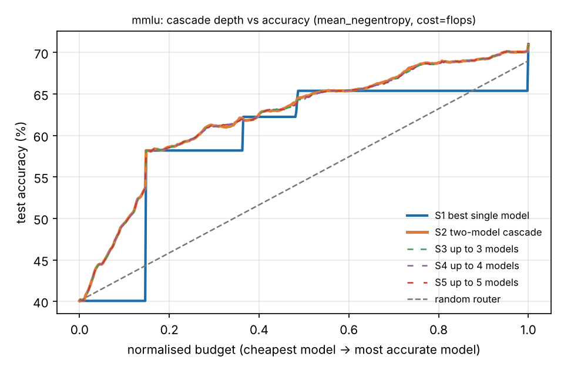

# Adaptive Stopping and Variable-Compute Inference

## Purpose

Methods that decide **whether to continue computation**: early exit, learned stopping, adaptive depth/recursion, or allocation of a finite reasoning/decoding budget. The module should consume a common model interface and return the prediction plus stopping metadata.

## Scope

In scope: early-exit heads, loop stopping, confidence/proxy-based stop policies, dynamic depth, token/step budgets, budget-aware inference policies.

Out of scope: general benchmark code (see `Performance_Metrics/`), attention kernel implementations (see `Attention/`), or model weights themselves (see `Backbones/`).

## Suggested structure

```text
Adaptive_Stopping/
├── README_adaptiveStopping.md
├── baselines/
├── methods/
│   ├── confidence_threshold/
│   ├── learned_exit/
│   └── budget_policy/
├── configs/
├── tests/
└── experiments/
```

Use one directory per method only once there is an owner. Avoid paper-specific copies of shared stopping utilities.

## Paper shortlist

- [TERMINATOR: Learning Optimal Exit Points for Early Stopping in Chain-of-Thought Reasoning](https://openreview.net/forum?id=GwTFovD6SM)
- [Step-Tagging Early-Stopping: Toward controlling the generation of Language Reasoning Models through black-box step monitoring](https://openreview.net/forum?id=bNn5OusO22)
- [Stabilizing Extrapolation in Looped Transformers via Learned Stochastic Stopping](https://openreview.net/forum?id=xExWu1Bhuw)
- [Learning Adaptive Reasoning Budgets via Constraint-Rectified Training](https://openreview.net/forum?id=1inovdFo6Z)
- [DIPA: Difficulty-Informed Probabilistic Allocation of Test-Time Compute via Training-Free Proxies](https://openreview.net/forum?id=9Joja0tx5c)
- [Block-Level Recursion: Adaptive Test-Time Routing in Large Language Models](https://openreview.net/forum?id=hLFRcxXKxY)
- [Learning Adaptive LLM Decoding](https://openreview.net/forum?id=14yhYy9m7S) — adaptive decoding policy.
- [Is Escalation Worth It? A Decision-Theoretic Characterization of LLM Cascades](https://arxiv.org/abs/2605.06350) — confidence-thresholded LLM cascades; **implemented**, see [LLM cascade escalation](#llm-cascade-escalation-bouchard-2026) and the [paper card](methods/cascade_escalation/PAPER_CARD.md).

Browse all accepted work in the [official paper index](https://adaptfm.gitlab.io/accepted-papers). Paper assignment is based on subject matter and may be cross-listed.

## Shared method contract

Every method should expose a comparable interface, for example:

```python
class StoppingPolicy:
    def reset(self, request_metadata=None): ...
    def should_stop(self, state, metrics, budget) -> bool: ...
    def report(self) -> dict: ...
```

The exact implementation can differ by model type; the contract must specify which state/metrics are required and whether they are available without an extra forward pass.

## Required evaluation

Report task quality against a no-stopping baseline; average and tail latency where appropriate; average depth/steps/tokens; peak memory; stop rate; and quality vs. compute-budget curves. Use identical prompt/input sets and seeds for baseline/method runs. If the policy adds a classifier or probe, include its compute and memory cost.

## Implementation checklist

- [ ] Describe the stop signal and the point in the forward/generation loop where it is evaluated.
- [ ] Identify any extra trained weights and the data used to fit them.
- [ ] Include a no-op/full-compute baseline and a simple threshold baseline where meaningful.
- [ ] Test budget edge cases (zero/minimum/maximum budget and missing telemetry).
- [ ] Record whether stopping is deterministic.
- [ ] Add quality-vs-latency plots or a machine-readable table in `Performance_Metrics/`.

## LLM cascade escalation (Bouchard 2026)

Implementation of *Is Escalation Worth It? A Decision-Theoretic Characterization of LLM Cascades* (Dylan Bouchard, ICML 2026 AdaptFM workshop, [arXiv 2605.06350](https://arxiv.org/abs/2605.06350)). Full details, differences from the paper and licences are in the [paper card](methods/cascade_escalation/PAPER_CARD.md).

### Team

Team: [Jigsaw442](https://github.com/Jigsaw442) (fork owner), [Boxbob](https://github.com/Boxbob), [paraskatiyar](https://github.com/paraskatiyar), [Sumit-Singatia-2027](https://github.com/Sumit-Singatia-2027).

### Method summary

A cascade is a stopping rule over a sequence of models instead of over layers or tokens. Models are ordered cheapest first. Each model answers the query and produces a confidence score from the log-probabilities of that same answer. If the score is at or above the stage's threshold the cascade stops and returns that answer; otherwise the query escalates to the next model, and the last model always answers. Cost is the sum over every model called.

- **Confidence scores** (no extra forward pass): mean normalised negentropy, minimum normalised negentropy, probability margin, minimum token probability and length-normalised probability, all from the top-15 token log-probs (`scores.py`).
- **Policy classes** `S_1 ⊂ S_2 ⊂ ... ⊂ S_5`: `S_d` contains every ordered model subsequence of length at most `d` with every threshold vector. `S_1` is "pick the best single model".
- **Selection:** for each cost budget, choose the calibration policy with the highest accuracy whose mean cost fits the budget, freeze it, and score it on the held-out split (`search.py`).
- **Diagnostics:** score AUROC, the paper's Prop. 3.2 condition for beating a random router, frontier concavity and stage-wise dominance (`theory.py`).
- **Live mode:** `CascadeStoppingPolicy` implements the module's `StoppingPolicy` contract (`reset` / `should_stop` / `report`), where `state` is the stage index and `metrics` holds the current model's score. It is used for the batch-size-1 latency and memory run.

### Models

| Stage order (by mean cost) | Hugging Face repo | Proposed backbone ID | Licence |
|---|---|---|---|
| 1 | `Qwen/Qwen2.5-0.5B-Instruct` | `llm.qwen2.5-0.5b-instruct` | Apache-2.0 |
| 2 | `Qwen/Qwen2.5-1.5B-Instruct` | `llm.qwen2.5-1.5b-instruct` | Apache-2.0 |
| 3 | `Qwen/Qwen2.5-3B-Instruct` | `llm.qwen2.5-3b-instruct` | Qwen Research |
| 4 | `microsoft/Phi-3.5-mini-instruct` (3.8B) | `llm.phi-3.5-mini-instruct` | MIT |
| 5 | `Qwen/Qwen2.5-7B-Instruct` | `llm.qwen2.5-7b-instruct` | Apache-2.0 |

Order is by the FLOP-proxy cost above; the search re-derives it from calibration mean cost on each split, so it is not hard-coded. All models run in bf16 with greedy decoding on one RTX 4090 (24 GB), one model loaded at a time. No Hugging Face token is needed.

### Offline protocol

The expensive part (generation) runs once; every policy is then evaluated offline on the stored outcomes, as in the paper.

1. **Collect.** For each benchmark (MMLU, TriviaQA, MATH levels 3 to 5; the paper's exact upstream prompts, 2,000 queries each, subsample seed 2026) and each model, store the answer, top-15 log-probs, the five confidence scores, correctness, input/output token counts and GPU time.
2. **Cost.** Primary: FLOP proxy `2 · N_params · (n_in + n_out)`. Secondary: GPU seconds, with batch wall time apportioned by `n_out + 1`. Both stand in for the paper's API prices.
3. **Split.** 50 stratified calibration/test splits per benchmark (seeds 42 to 91).
4. **Search.** On the calibration half, enumerate every ordered subsequence up to depth 5 with its thresholds. Depth 2 is exhaustive over calibration score partitions; depths 3, 4 and 5 use quantile grids of 128, 40 and 16 thresholds per stage plus never/always sentinels, which keeps the classes nested.
5. **Budgets.** 500 budgets spanning the calibration cost range. For each budget and policy class, select on calibration, evaluate on test.
6. **Report.** Accuracy vs. cost frontiers per class, `S_2 - S_1` and `S_3 - S_2` gains averaged over splits, and the diagnostics above.

### Baselines

| Baseline | Definition | Code |
|---|---|---|
| Always-small | Every query answered by Qwen2.5-0.5B-Instruct. | `baselines/cascade_baselines.py::always_model` |
| Always-large | Every query answered by Qwen2.5-7B-Instruct (the no-stopping, full-compute baseline). | `baselines/cascade_baselines.py::always_model` |
| Random router | Escalate a uniformly random fraction `t` of queries from small to large; its expected accuracy is the straight line between the two models at cost `c_small + t · c_large`. | `baselines/cascade_baselines.py::random_router` |
| Best single model (`S_1`) | Best single model within each budget, chosen on calibration. | `methods/cascade_escalation/search.py` |

### Reproduction

```bash
# 1. GPU generation (RTX 4090, roughly 2 to 4 hours)
bash Adaptive_Stopping/experiments/cascade_escalation/run_gpu.sh
#    -> results/cascade/generations/<dataset>/<slug>.jsonl.gz, results/cascade/meta/<slug>.json,
#       results/cascade/live/ (batch-size-1 cascade latency and memory)

# 2. Offline sweep (CPU only)
python Adaptive_Stopping/experiments/cascade_escalation/run_sweep.py \
  --config Adaptive_Stopping/experiments/cascade_escalation/configs/qwen25_phi35_pool.yaml \
  --results results/cascade
#    -> results/cascade/sweep/*.csv, plots, Performance_Metrics/results/cascade_escalation.csv

# Tests
pytest Adaptive_Stopping/tests -q
```

### Results

Status: **partial reproduction** (open models on 1x RTX 4090 instead of the paper's API models; FLOP-proxy and GPU-time costs instead of USD). Full tables, plots and run metadata: [`experiments/cascade_escalation/results_rtx4090/`](experiments/cascade_escalation/results_rtx4090/); details and caveats in the [paper card](methods/cascade_escalation/PAPER_CARD.md#results).

Paper reference (Table 1, mean-negentropy score, API models): `S_2 - S_1` = +3.93 pp MMLU, +5.72 pp TriviaQA, +2.80 pp MATH; `S_3 - S_2` negative in 38 of 45 cases.

Ours (cost = FLOP proxy, score = mean negentropy, test accuracy area-averaged over 500 budgets, mean over 50 splits):

| Benchmark | Score | Always-small acc. | Always-large acc. | `S_1` acc. (area) | `S_2` acc. (area) | `S_2 - S_1` (pp, mean ± sd over 50 splits) | `S_3 - S_2` (pp) | Score AUROC (small model) |
|---|---|---:|---:|---:|---:|---:|---:|---:|
| MMLU | mean_negentropy | 40.1% | 71.0% | 59.7% | 62.3% | +2.54 ± 0.46 | −0.04 | 0.62 |
| TriviaQA | mean_negentropy | 0.1% | 51.2% | 36.8% | 40.6% | +3.75 ± 0.37 | −0.01 | n/a (small model ~never correct) |
| MATH (L3-5) | mean_negentropy | 25.1% | 62.7% | 47.6% | 50.9% | +3.34 ± 0.38 | +0.002 | 0.72 |

Across 7 informative scores × 3 benchmarks × 2 cost measures, `S_2 - S_1` is +1.7 to +6.1 pp, and `S_3`/`S_4`/`S_5 - S_2` is ≤ 0 in 122 of 126 comparisons (the rest ≤ +0.002 pp): the paper's main finding, that cascades deeper than two models rarely pay, reproduces.

Live batch-size-1 run (RTX 4090, Qwen2.5-0.5B → Qwen2.5-7B, MMLU, 200 test queries; both models resident):

| Configuration | Accuracy | Latency median (ms) | Latency p95 (ms) | Mean models called | Peak memory (MB) |
|---|---:|---:|---:|---:|---:|
| Always-small | 38.0% | 42 | 46 | 1.00 | 15,560 |
| Always-large | 57.5% | 54 | 77 | 1.00 | 15,656 |
| `S_2` cascade, 25% budget | 46.5% | 43 | 119 | 1.24 | 15,616 |
| `S_2` cascade, 50% budget | 53.0% | 93 | 120 | 1.54 | 15,627 |
| `S_2` cascade, 75% budget | 58.5% | 96 | 128 | 1.79 | 15,656 |

The cascade cuts compute (3.02 vs 3.36 TFLOPs/query at slightly higher accuracy) but not batch-1 latency: on one GPU the 7B model is bandwidth-bound and nearly as fast as the 0.5B model on short answers, so running both on escalated queries is slower. Peak memory is for both models loaded; weights alone are 0.95 GB (0.5B) and 14.6 GB (7B). TriviaQA and MATH live rows are in [`live_summary.csv`](experiments/cascade_escalation/results_rtx4090/live/live_summary.csv).



### Result-row schema

Summary rows in `Performance_Metrics/results/cascade_escalation.csv` are area-averaged over the 500-budget grid and the 50 splits, one per (benchmark, cost_unit, score, policy class), with `budget_index` = `all (area)`. Measured live batch-size-1 rows are added alongside them. Per-budget detail lives in `results/cascade/sweep/` (`summary.csv`, `depth_gains.csv`, `theory.csv`, `models.csv`, `curves.npz`, `plots/*.png`). Columns follow the [`Performance_Metrics` report format](../Performance_Metrics/README_metrics.md#required-report-format). The first 24 columns are the shared header; the rest are cascade-specific. An empty header-only template is in [`Performance_Metrics/results/cascade_escalation_schema.csv`](../Performance_Metrics/results/cascade_escalation_schema.csv).

```text
experiment_id,paper_id,method,commit,backbone_id,backbone_revision,dataset_id,split,seed,device,framework_version,dtype,batch_size,input_length,output_length,quality_metric,quality_value,latency_median_ms,latency_p95_ms,throughput,peak_memory_mb,energy_j,status,notes,policy_class,score_name,model_sequence,thresholds,budget_index,budget,cost_unit,mean_cost,escalation_rate,mean_models_called,effective_depth,n_cal,n_test,threshold_grid
```

| Column | Meaning for the cascade |
|---|---|
| `paper_id` | `arxiv:2605.06350` |
| `method` | `cascade_escalation`, `always_small`, `always_large`, `random_router` or `best_single` |
| `backbone_id` | Models in the selected policy joined with `>`, cheapest first (e.g. `llm.qwen2.5-0.5b-instruct>llm.qwen2.5-7b-instruct`) |
| `backbone_revision` | Matching HF revisions joined with `>` |
| `dataset_id` / `split` | Benchmark ID / `test` (the held-out half; selection always uses `cal`) |
| `seed` | Calibration/test split seed (42 to 91) for per-split rows; empty for area-averaged rows |
| `batch_size` | Generation batch size for offline rows; `1` for live rows |
| `quality_metric` / `quality_value` | `accuracy` / test accuracy in [0, 1] |
| `latency_*`, `throughput`, `peak_memory_mb` | Filled for live rows only; empty with a `notes` entry for offline rows |
| `energy_j` | Empty (`not_measured`) |
| `status` | `partial-reproduction` until all benchmarks are run |
| `policy_class` | `S1` to `S5`, or the baseline name |
| `score_name` | One of the five confidence scores; empty for baselines |
| `model_sequence` | Model slugs of the frozen policy, `>`-joined |
| `thresholds` | Thresholds per non-terminal stage, `;`-joined (`-inf` = never escalate, `inf` = always escalate) |
| `budget_index` / `budget` | Index into the 500-budget grid and the budget in `cost_unit`, or `all (area)` with an empty budget for area-averaged rows |
| `cost_unit` | `flop_proxy` or `gpu_seconds` |
| `mean_cost` | Test mean cost per query in `cost_unit` |
| `escalation_rate` | Fraction of test queries that left the first stage |
| `mean_models_called` | Average number of models called per query |
| `effective_depth` | Number of stages that receive any traffic |
| `n_cal` / `n_test` | Calibration and test query counts |
| `threshold_grid` | `exhaustive` for depth 2, otherwise the per-stage grid size |
