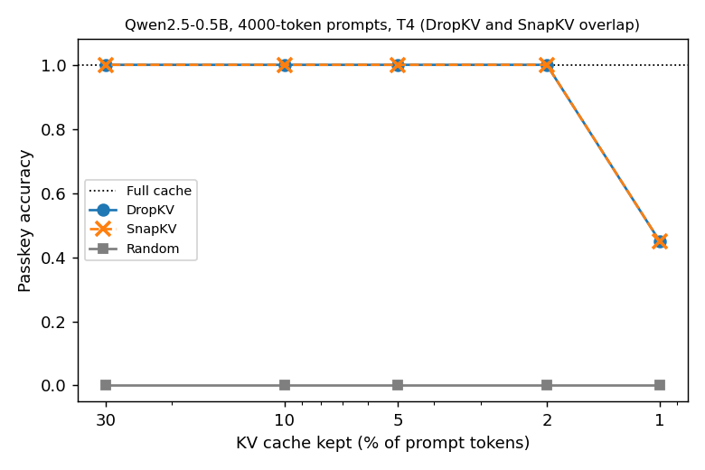
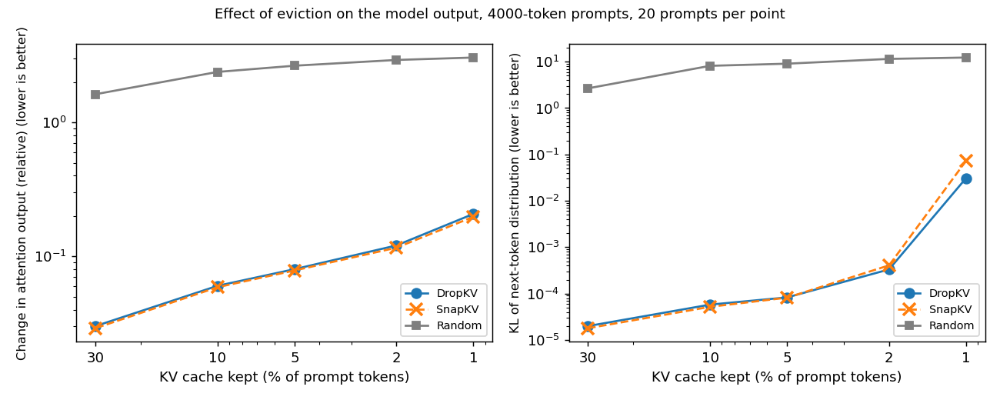

# Paper implementation card: DropKV: Decoupling Residual-Output Perturbation for Near-Optimal KV-Cache Eviction

- **Paper / OpenReview:** https://openreview.net/forum?id=MqfNzH3TVH (AdaptFM, ICML 2026 workshop). The paper is also on arXiv: https://arxiv.org/abs/2610.22130. We read the method and the reported numbers from the arXiv version.
- **Primary module:** `Attention/` (`Attention/methods/kv_eviction/`)
- **Secondary modules:** `Dataloaders/synthetic/`, `Backbones/Generative_Pretrained/`, `Performance_Metrics/`
- **Owner / reviewer:** Deval Singhal (@maidevalhoon). Team: Deval Singhal (230101035), Jayant Kumar (230101050), Sonal Mangesh Wagh (230108054), Sristi Vats (230122057), Shourya Veer Singh (230106069)
- **Division of work:** [CONTRIBUTIONS.md](CONTRIBUTIONS.md)
- **Status:** partial-reproduction
- **Upstream code / licence:** https://github.com/AozhongZhang/DropKV (Apache-2.0). The method is also in NVIDIA kvpress as `DropKVPress`. We did not use either. Our code is plain PyTorch written from Algorithm 1 of the paper.
- **Backbone IDs:** `text.qwen2_5_0_5b_instruct.self_supervised` ([model card](../../../Backbones/Generative_Pretrained/qwen2_5_0_5b_instruct.md))
- **Dataset IDs and split:** `text.passkey_retrieval.synthetic`, split `synthetic` ([dataset card](../../../Dataloaders/synthetic/passkey_retrieval.md))
- **Hardware assumptions:** anything PyTorch runs on, no custom kernels. The accuracy, latency and memory numbers below come from one Tesla T4 (15 GB, Colab, fp16). The output-perturbation numbers come from a MacBook CPU (Apple M1, 8 GB, float32).

## Research summary

### Problem

A language model keeps the keys and values of every token it has read (the KV cache). The cache grows with the length of the prompt, and for long prompts it can take more memory than the model weights. Eviction methods drop part of the cache right after the prompt has been processed. Most of them rank tokens only by how much attention they receive and do not look at the value vectors, so they can drop a token whose removal changes the output a lot.

### Method

Take one query with attention weights `p` over the cached tokens and output `a = sum_i p_i v_i`. If token `j` is removed and the attention is renormalised, the output moves by

    Delta({j}) = p_j / (1 - p_j) * (a - v_j)

(Lemma 1 in the paper). The best set of `k` tokens to remove is the one with the smallest total change, but finding it is NP-hard because removed tokens interact. DropKV skips the interaction and scores every token on its own, summed over the last `w` queries of the prompt:

    score_j = sum over the window queries t of (p_j / (1 - p_j))^2 * || a - v_j ||^2

The scores are max-pooled over neighbouring positions (kernel 11), the last `w = 8` tokens are always kept, and the `k` tokens with the lowest score are evicted. This is done separately for each head and layer.

SnapKV ranks tokens by the attention they receive and nothing else, so the only difference is the factor `||a - v_j||^2`. A token whose value is already close to the output is cheap to remove however much attention it gets. The paper proves that choosing tokens one by one this way is within a constant factor of the best set, if the removed tokens have small attention weights and their residuals `a - v_i` point in roughly the same direction.

### Expected behaviour

In the paper (A100-80GB, RULER at 128K tokens, 5% cache budget) DropKV reaches an average accuracy of 82.00 on Llama-3.1-8B-Instruct, 83.77 on Qwen2.5-7B-Instruct-1M and 85.40 on MegaBeam-Mistral-7B-512K. That is 2.4 to 7.7 points above SnapKV and 2.35 to 4.03 points above the best other baseline. On LongBench at 5% the averages are 45.51, 42.66 and 36.22. Their fused Triton scoring kernel is reported to be 19.8x faster than a PyTorch reference at 128K tokens and to give up to 9.9% faster prefill.

We did not measure any of these. Our own numbers are in the Results section and come from a much smaller setup.

## Implementation

- **Input contract:** window queries `q [B, H, W, D]` and cached keys and values `k, v [B, H, N, D]`, any float dtype (scores are computed in float32). For Hugging Face models the queries are recorded with forward hooks on each attention layer (`q_proj` of the last `W` positions, with RoPE applied). With grouped-query attention, the query heads that share a KV head are added as extra window queries of that head. Batch size 1.
- **Output contract:** scores `[B, H, N]`, float32. Kept indices `[B, H, n_keep]`, sorted, always including the last `W` positions. The cache is shortened in place to `[B, H, n_keep, D]` and decoding continues with the original position ids.
- **Configuration:** [`qwen2_5_0_5b.yaml`](../../configs/dropkv/qwen2_5_0_5b.yaml) (30% and 10% budgets), [`qwen2_5_0_5b_low_budget.yaml`](../../configs/dropkv/qwen2_5_0_5b_low_budget.yaml) (5%, 2%, 1%) and [`perturbation.yaml`](../../configs/dropkv/perturbation.yaml). Main fields: `budgets` (share of positions kept per head), `window` (8), `kernel_size` (11), `methods`, `context_tokens`, `model_revision`.
- **Reproduction commands** (more in [README.md](README.md)):
  - `python -m Attention.experiments.dropkv.run_benchmark --config Attention/configs/dropkv/qwen2_5_0_5b.yaml`
  - `python -m Attention.experiments.dropkv.run_perturbation --config Attention/configs/dropkv/perturbation.yaml`
- **Tests:** `python -m pytest Attention/tests/test_dropkv.py -q` (26 tests, CPU only, nothing is downloaded)

| File | Content |
|---|---|
| `Attention/methods/kv_eviction/scoring.py` | attention of the window queries, DropKV / SnapKV / random scores, pooling and top-k selection, attention-output shift |
| `Attention/methods/kv_eviction/eviction.py` | query-recording hooks, cache compression, prompt pass and greedy decoding on the shortened cache |
| `Attention/methods/kv_eviction/perturbation.py` | Lemma 1, exact objective and brute-force optimum for small cases |
| `Attention/tests/test_dropkv.py` | tests |
| `Attention/experiments/dropkv/run_benchmark.py` | accuracy, latency and memory |
| `Attention/experiments/dropkv/run_perturbation.py` | change of the attention output and of the next-token distribution |
| `Attention/experiments/dropkv/make_plots.py` | the two figures below |

What the tests check:

- The closed form of Lemma 1 equals recomputing the attention after really removing the tokens (double precision).
- With one query, the DropKV score equals the squared output change of removing each token.
- The memory-lean scoring code equals the direct formula, and half-precision inputs are scored in float32.
- Exactly `k` positions are evicted per head and the last `W` are never evicted.
- On small random cases the bound of Theorem 1 holds against a brute-force search over all subsets.
- The queries we record with hooks reproduce the attention weights the model itself reports (tiny random Llama).
- With a 100% budget, generation is identical to the unmodified model.

## Results

In short: the implementation works, and the cache can be cut to 2% of the prompt without losing the passkey. In our tests DropKV did not do better than SnapKV, which is what the paper claims, so we count this as a partial reproduction.

We ran three experiments, all with Qwen2.5-0.5B-Instruct on synthetic passkey prompts (20 prompts per setting, batch size 1, greedy decoding):

1. Accuracy, latency and memory on a Colab Tesla T4 (15 GB, fp16, torch 2.14.1, transformers 5.23.0), 30% and 10% budgets at 2000 and 4000 tokens.
2. The same on the T4 at 5%, 2% and 1% budgets at 4000 tokens.
3. How much each method changes the model output, on a MacBook CPU (Apple M1, 8 GB, float32, torch 2.15.0, transformers 5.23.0).

Latency is the median time for one request (prompt pass, scoring, eviction and decoding). Throughput is decode tokens per second. Peak memory is `torch.cuda.max_memory_allocated` during the prompt pass. Raw rows are in [`results/results.csv`](results/results.csv), [`results_low_budget/results.csv`](results_low_budget/results.csv) and [`results_perturbation/perturbation.csv`](results_perturbation/perturbation.csv), each with an `environment.json` next to it. The rows of the first two are also in `Performance_Metrics/results/dropkv_qwen2_5_0_5b.csv`.

### Accuracy, latency and memory (T4)

Prompts of about 4000 tokens (4006 after the chat template):

| Source | Quality | Latency | Throughput | Peak memory | Energy | Notes |
|---|---:|---:|---:|---:|---:|---|
| Paper-reported | 82.00 / 83.77 / 85.40 avg. RULER score | not given as absolute | 1.75-8.22x decode throughput vs dynamic cache | scoring scratch ~17 MB vs ~9 GB | not reported | Llama-3.1-8B / Qwen2.5-7B-1M / Mistral-7B-512K, 128K tokens, 5% budget, A100-80GB. Different models, task and length: not comparable with the rows below |
| Local baseline (full cache) | 1.00 | 402.3 ms | 36.4 tok/s | 2173.6 MB | not measured | KV cache 46.95 MB |
| Local method, DropKV 30% | 1.00 | 434.4 ms | 32.2 tok/s | 2178.0 MB | not measured | KV cache 14.09 MB |
| Local method, DropKV 10% | 1.00 | 445.4 ms | 33.2 tok/s | 2178.0 MB | not measured | KV cache 4.70 MB |
| Local method, DropKV 5% | 1.00 | 440.9 ms | 32.4 tok/s | 2178.0 MB | not measured | KV cache 2.34 MB |
| Local method, DropKV 2% | 1.00 | 449.3 ms | 30.7 tok/s | 2178.0 MB | not measured | KV cache 0.94 MB |
| Local method, DropKV 1% | 0.45 | 454.8 ms | 29.3 tok/s | 2178.0 MB | not measured | KV cache 0.47 MB |

Accuracy against cache budget (4000 tokens):

| Budget | 30% | 10% | 5% | 2% | 1% |
|---|---:|---:|---:|---:|---:|
| DropKV | 1.00 | 1.00 | 1.00 | 1.00 | 0.45 |
| SnapKV | 1.00 | 1.00 | 1.00 | 1.00 | 0.45 |
| Random | 0.00 | 0.00 | 0.00 | 0.00 | 0.00 |

At about 2000 tokens it looks the same: full cache, DropKV and SnapKV score 1.00 at 30% and 10%, random scores 0.05 and 0.00.

Cost of the method at 4000 tokens and a 10% budget:

| | Full cache | DropKV 10% | SnapKV 10% |
|---|---:|---:|---:|
| Prefill, median (ms) | 264.5 | 299.2 | 286.2 |
| Decode, median (ms/token) | 27.1 | 28.6 | 29.6 |
| KV cache (MB) | 46.95 | 4.70 | 4.70 |
| Peak memory during decode (MB) | 2167.8 | 2124.8 | 2124.8 |

What we take from this:

- Eviction that follows the window attention works on this task. The cache goes from 46.95 MB to 0.94 MB (2%) with no loss of accuracy, while random eviction fails at every budget.
- DropKV and SnapKV have the same accuracy at every budget, including 1% where both drop to 0.45. A single passkey that the final question points at is too easy to separate an attention-only score from a value-aware one.
- Scoring is not free. The prompt pass is about 13% slower with DropKV and about 8% slower with SnapKV than with no eviction.
- Decoding did not get faster. With a 0.5B model and a 4000-token prompt the cache is under 50 MB, so decoding is not limited by it. The paper's throughput gains come from 32K to 128K tokens and large batches, which we did not test.
- Peak memory in the prompt pass does not change, because the whole prompt is processed before anything is evicted. The decode-time peak drops by 43 MB, which is the size of the evicted cache.
- We measured the full-cache baseline in both T4 runs (402.3 ms and 423.1 ms median), so latency differences of a few percent are within run-to-run variation.

### Effect on the model output (CPU)

Accuracy cannot separate the two methods here, so we measured the effect of eviction directly with [`run_perturbation.py`](run_perturbation.py). For every prompt the cache is built once and each method is applied to the same cache. We record two numbers, and lower is better for both:

- `attn_shift`: the relative change of the attention output of the 8 window queries, `||a_kept - a_full|| / ||a_full||`, averaged over queries, heads and layers. This is the quantity DropKV's score is built from.
- `next_token_kl`: the KL divergence between the next-token distribution with the full cache and with the shortened cache, at the first decoding step.

Prompts of about 4000 tokens:

| Budget | DropKV shift | SnapKV shift | Random shift | DropKV KL | SnapKV KL | Random KL | DropKV lower than SnapKV on (shift / KL) |
|---|---:|---:|---:|---:|---:|---:|---:|
| 30% | 0.0302 | 0.0291 | 1.62 | 2e-05 | 1.8e-05 | 2.67 | 0% / 35% of prompts |
| 10% | 0.0603 | 0.0588 | 2.38 | 5.8e-05 | 5.2e-05 | 8.15 | 0% / 20% of prompts |
| 5% | 0.0802 | 0.0785 | 2.65 | 8.3e-05 | 8.2e-05 | 9.06 | 0% / 50% of prompts |
| 2% | 0.121 | 0.116 | 2.92 | 0.000333 | 0.000407 | 11.5 | 0% / 45% of prompts |
| 1% | 0.207 | 0.197 | 3.05 | 0.031 | 0.073 | 12.3 | 0% / 80% of prompts |

Prompts of about 2000 tokens:

| Budget | DropKV shift | SnapKV shift | Random shift | DropKV KL | SnapKV KL | Random KL | DropKV lower than SnapKV on (shift / KL) |
|---|---:|---:|---:|---:|---:|---:|---:|
| 30% | 0.0278 | 0.0269 | 1.59 | 9e-06 | 7e-06 | 2.3 | 0% / 30% of prompts |
| 10% | 0.059 | 0.0571 | 2.4 | 3.2e-05 | 2.9e-05 | 8.22 | 0% / 35% of prompts |
| 5% | 0.091 | 0.0883 | 2.7 | 0.000193 | 0.000216 | 11.2 | 0% / 55% of prompts |
| 2% | 0.212 | 0.199 | 2.98 | 0.0106 | 0.13 | 12.7 | 0% / 70% of prompts |
| 1% | 0.39 | 0.388 | 3.1 | 6.97 | 7.44 | 12.4 | 20% / 50% of prompts |

`attn_shift` is measured on the same window queries the scoring used, `next_token_kl` is not. The KL values from 30% to 5% are around 1e-5 to 1e-4 and are close to numerical noise. Each row averages 20 prompts.

What we take from this:

- Both attention-guided methods change the output far less than random eviction. At 10% the attention output moves by about 0.06 for them and by 2.4 for random.
- On `attn_shift`, DropKV is slightly worse than SnapKV in all 10 settings (2 lengths x 5 budgets), by 0.5% to 6.5%. DropKV is lower on none of the prompts in 9 of the settings and on 20% of them in the remaining one.
- On `next_token_kl`, DropKV has the lower mean in 5 of the 10 settings, mostly at the smallest budgets (0.031 against 0.073 at 4000 tokens and 1%, 0.011 against 0.130 at 2000 tokens and 2%). The share of prompts where it is lower ranges from 20% to 80% and averages 47%, so there is no consistent difference.
- So these experiments do not show the advantage over SnapKV that the paper reports. We did not look into why. Possible reasons are the small model, the short prompts, the max-pooling and protected window that both methods share, and that the paper's guarantee is about the exact single-query objective while we average over heads, layers and 8 queries.

## Differences and limitations

- **Model:** Qwen2.5-0.5B-Instruct instead of the 7 to 8B models of the paper.
- **Context length:** about 2K and 4K tokens instead of 16K to 128K.
- **Task:** synthetic passkey retrieval instead of RULER and LongBench, so the accuracy numbers cannot be compared with the paper's tables. DropKV and SnapKV have the same accuracy here and the output-perturbation measurement shows no consistent advantage for DropKV, so the paper's improvement over SnapKV is not reproduced.
- **Kernels:** we did not write the Triton kernels. Our scoring uses the same expansion `||a||^2 + ||v||^2 - 2<a, v>`, which avoids the `[W, N, D]` temporary, but it still builds the `[W, N]` attention weights. The 19.8x kernel speedup is not reproduced.
- **Baselines:** full cache, SnapKV and random only. AnDPro, CriticalKV, CAKE, PyramidKV, KeyDiff and the adaptive head budget variant (AdaDropKV) are not included.
- **Sample size:** 20 prompts per setting, one seed, one run. Small differences between methods should not be over-read.
- **Batching and models:** batch size 1. Only Hugging Face models whose attention layers have `q_proj` and receive rotary `position_embeddings` work (Llama and Qwen2 style). Only transformers 5.23.0 was tested.
- **Energy:** not measured.

## Reproduction checklist

- [x] Exact paper link and version verified
- [x] Base model and dataset revisions pinned
- [x] Baseline runs on the same setup
- [x] Tests and seed handling added
- [x] Resource and quality metrics reported
- [x] Licence/data terms checked
