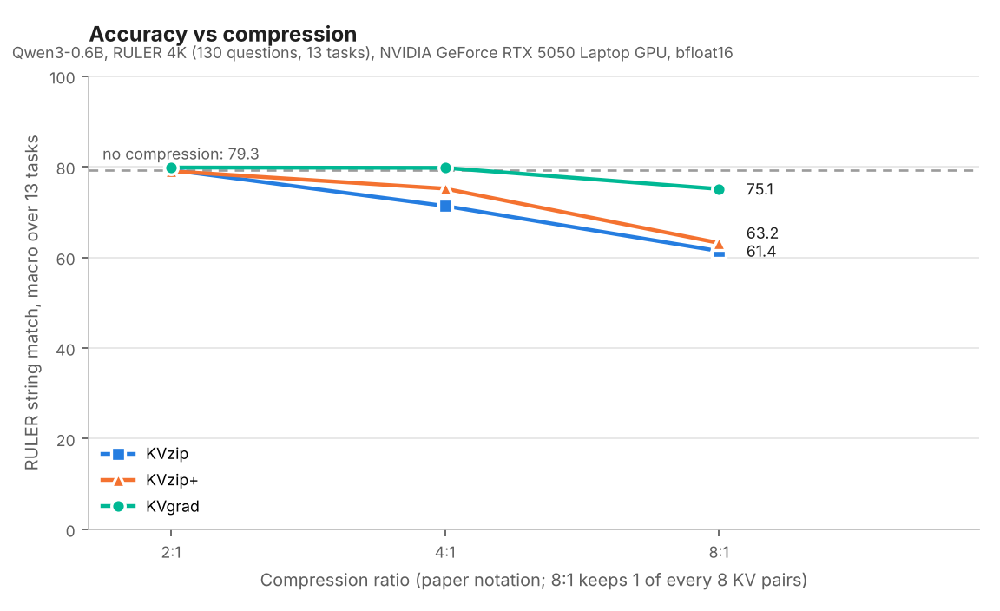
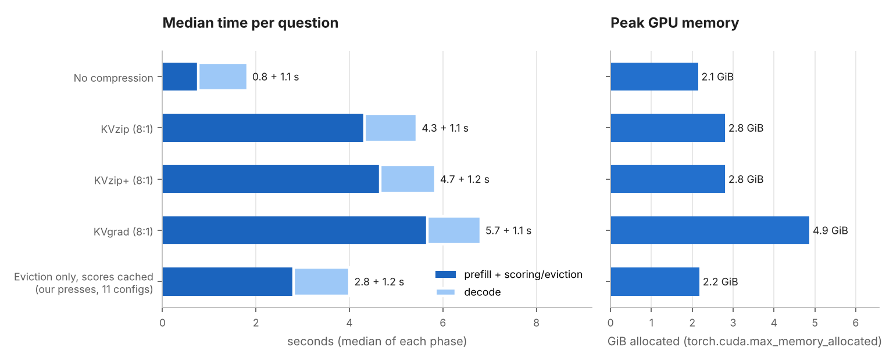

# Paper implementation card: KVgrad: Query-Agnostic KV Cache Eviction via Gradient-based Global Importance Scoring

- **Paper / OpenReview:** https://openreview.net/forum?id=cg1wTCJjjk (AdaptFM workshop, ICML 2026; Kwak, Joo, Hwang, Byun, Moon, Seoul National University)
- **Primary module:** `Attention/` (KV cache and long-context memory)
- **Secondary modules:** `Performance_Metrics/` (latency and memory protocol)
- **Team Members:** Mathangi Venkatraman Srinivasan - 230121037 (mathangiVS), Sanjay G - 230121049 (sanjayganeshprabu), Venkat Sai Teja Kalluri - 230121032 (teja123git), Vipul Sharma - 230103117 (Vipulsoc), Kondapi Venkata Dhruv 230122024 (kvdhruv)
- **Tracking issue:** krsnoki/DA4022#8
- **Status:** `partial-reproduction` (one model, RULER 4K subset, 2:1 to 32:1; main claim and ablation trend reproduced)
- **Upstream code / licence:** NVIDIA kvpress, https://github.com/NVIDIA/kvpress, Apache-2.0. Version `0.5.5` already ships `KVgradPress` (`kvpress/presses/kvgrad_press.py`), which implements the paper's final score, Eq. (8). The intermediate scores of the paper's ablation, Eqs. (6) and (7), are not in kvpress. No separate code release by the authors was found.
- **Backbone IDs:** `Qwen/Qwen3-0.6B`, Hugging Face revision `c1899de289a04d12100db370d81485cdf75e47ca` (pinned in the config)
- **Dataset IDs and split:** `simonjegou/ruler`, `data_dir=4096`, split `test` (RULER as packaged by kvpress, 13 tasks x 500 examples, ~4K-token contexts); per-task stratified sample with seed 42
- **Hardware:** main results on one NVIDIA GeForce RTX 5050 Laptop GPU (8 GB), driver 592.27, Windows 11, **bfloat16**; dry run on an NVIDIA T4 (Google Colab, fp32). `sdpa` attention (`eager` is rejected by KVzip/KVgrad; FlashAttention-2 not used)

## Research summary

### Problem
Long-context inference is memory-bandwidth bound: every generated token reads the whole key-value (KV)
cache. Query-agnostic eviction removes cache entries once, using only the context, so the compressed
cache can be reused for any later question. Existing query-agnostic scores (KVzip, KVzip+) judge an entry
only by its contribution to the attention output **in its own layer**, ignoring how that contribution
propagates through later layers to the model's final representation.
### Method
Like KVzip, KVgrad appends a "Repeat the previous context:" prompt followed by a copy of the context, and
uses these replay tokens $`p \in P`$ as probes. With $`A^{\ell}_{p,c}`$ the attention from probe $`p`$ to cache
entry $`c`$ at layer $`\ell`$, $`v^{\ell}_{c}`$ its value vector, $`W^{\ell}_{O}`$ the output projection and
$`a^{\ell}_{p} = \sum_{t} A^{\ell}_{p,t}\, v^{\ell}_{t} W^{\ell}_{O}`$ the attention output, the scores compared in
this project are:

| Score | Definition | Paper |
|---|---|---|
| KVzip | $`S_{\ell,c} = \max_{p} A^{\ell}_{p,c}`$ | Eq. (3) |
| KVzip+ | $`S_{\ell,c} = \max_{p} A^{\ell}_{p,c}\, \lVert v^{\ell}_{c} W^{\ell}_{O}\rVert_2 \,/\, \lVert x^{\ell}_{p}\rVert_2`$ | Eq. (4) |
| First-order Taylor | $`\sum_{p} A^{\ell}_{p,c}\,\big(v^{\ell}_{c} W^{\ell}_{O}\big)\cdot \nabla_{a^{\ell}_{p}}\Phi`$ | Eq. (6) |
| Magnitude-aware bound | $`\lvert T^{\ell}_{p,c}\rvert \le A^{\ell}_{p,c}\,\lVert v^{\ell}_{c} W^{\ell}_{O}\rVert_2\,\lVert \nabla_{a^{\ell}_{p}}\Phi\rVert_2`$ | Eq. (7) |
| **KVgrad** | $`S_{\ell,c} = \max_{p}\, A^{\ell}_{p,c}\,\lVert v^{\ell}_{c} W^{\ell}_{O}\rVert_2\,\lVert \nabla_{a^{\ell}_{p}}\Phi\rVert_2`$ | **Eq. (8)** |

Here $`\Phi = \sum_{p} \lVert x^{L+1}_{p} \rVert_2^2`$ summarises the final hidden states, so
$`\nabla_{a^{\ell}_{p}}\Phi`$ (one backward pass) measures how much the output depends on layer $`\ell`$'s
attention output at probe $`p`$. Eq. (6) is the first-order estimate of removing $`v^{\ell}_{c}`$; Eq. (7) keeps only
magnitudes because raw gradient directions are noisy; Eq. (8) replaces the sum over probes by a max so an
entry that matters to a single probe is not averaged away. The lowest-scoring fraction of entries
(`compression_ratio`) is evicted across all layers and heads.

### Expected behaviour

Score-variant ablation for Qwen3-0.6B reported in the paper's appendix Table 4 (RULER, 10% of the
examples, string match):

| Variant | 8:1 | 16:1 | 32:1 |
|---|---:|---:|---:|
| `taylor_sum`, Eq. (6) | 73.15 | 54.51 | 24.37 |
| `taylor_max` | 72.24 | 55.83 | 24.45 |
| `bound_sum`, Eq. (7) summed | 72.33 | 55.96 | 36.32 |
| `bound_max`, Eq. (8) KVgrad | 69.66 | 57.21 | 40.20 |

For this small model the variants are close at 8:1 and separate at 16:1 and 32:1, where the magnitude-aware
max (KVgrad) is best; hence the ablation is run at 8:1, 16:1 and 32:1.

Main comparison:
Paper-reported RULER string match for Qwen3-0.6B (macro average over the 13 tasks, **computed by us from
the paper's appendix Table 7**; the paper reports per-task values):

| Compression | No press | KVzip | KVzip+ | KVgrad |
|---|---:|---:|---:|---:|
| none | 78.2 | | | |
| 2:1 (`compression_ratio=0.5`) | | 78.0 | 78.1 | 78.1 |
| 4:1 (`0.75`) | | 68.5 | 72.7 | 77.1 |
| 8:1 (`0.875`) | | 55.6 | 60.1 | 72.2 |

Cost: KVgrad needs one extra forward and backward pass over the replayed context, which kvpress estimates
at 3-4x the prefill cost (KVzip: 2-3x). The paper's trainable MLP surrogate, KVgrad (MLP), removes this cost
at inference; it is out of scope here.

## Implementation

- **Input contract:** a RULER example (`context`, `question`, `answer_prefix`, `max_new_tokens`); batch size 1; contexts of ~3.4K-4K tokens.
- **Output contract:** generated answer string; per-example latency (total, prefill + compression, decode), peak GPU memory, input/output token counts; per-configuration `metrics.json`; `summary.csv` in the schema of `Performance_Metrics/README_metrics.md`.
- **Configuration:** `Attention/experiments/kvgrad/configs/ruler4k_qwen3_0.6b.yaml` (baselines, ratios 0.5 / 0.75 / 0.875) and `configs/ruler4k_qwen3_0.6b_ablation.yaml` (score variants, 0.875 / 0.9375 / 0.96875); 10 examples per task, seed 42. The main runs override `dtype` with `--dtype bfloat16`.
- **Reproduction commands** (from `Attention/experiments/kvgrad/`; same output folder so both runs share the sampled rows):
  `python run_ruler.py --config configs/ruler4k_qwen3_0.6b.yaml --dtype bfloat16 --output_dir <dir>`
  `python run_ruler.py --config configs/ruler4k_qwen3_0.6b_ablation.yaml --dtype bfloat16 --output_dir <dir>`
  `python make_plots.py --results <dir>` (figures and per-task table)
- **Own implementation:** [`Attention/methods/context_compression/kvgrad/`](../../methods/context_compression/kvgrad/README.md).
  `scores.py` computes the four score variants of the paper's ablation (Eqs. 6, 7 summed, max-Taylor, Eq. 8)
  from the replay quantities; `press.py` (`KVgradVariantsPress`) plugs them into kvpress's replay and eviction,
  with an optional cache so one replay serves all variants and ratios. Benchmark names: `kvgrad_taylor_sum`,
  `kvgrad_taylor_max`, `kvgrad_bound_sum`, `kvgrad_bound_max`.
- **Ablation configuration:** `configs/ruler4k_qwen3_0.6b_ablation.yaml` (the four variants at 8:1, 16:1, 32:1).
- **Tests:** `python -m pytest Attention/tests -q` (CPU, tiny random Qwen3, no downloads; 12 tests):
  - Eq. (6): Taylor terms summed over probes and heads equal $v \cdot \nabla_v \Phi$ from autograd (float64, rtol 1e-10).
  - Eq. (7): the magnitude bound holds for every probe and entry.
  - Reference check: our `bound_max` reproduces kvpress's `KVgradPress` scores (rtol 1e-5, atol 1e-7) and evicts exactly the same KV pairs, with one and with several replay chunks; through `run_ruler.py` it gives identical answers.
  - Score cache: cached scores evict exactly what a fresh press evicts, for every variant and ratio.
  - Benchmark script: end-to-end run of all presses, output schema, scoring function, resuming.

## Results

**Main runs:** RTX 5050 Laptop GPU, bfloat16, Qwen3-0.6B (`c1899de`), RULER 4K, **130 examples (10 per task,
13 tasks, seed 42), identical rows for every configuration**, batch size 1, one untimed warm-up per configuration,
CUDA-synchronised timing of the full pipeline call (tokenisation, prefill, scoring/eviction, decoding).
Machine-readable rows (one per configuration, schema of `Performance_Metrics/README_metrics.md`):
[`results_rtx5050_bf16/summary.csv`](results_rtx5050_bf16/summary.csv); per-task scores:
[`results_rtx5050_bf16/per_task_scores.csv`](results_rtx5050_bf16/per_task_scores.csv); environment:
[`results_rtx5050_bf16/env.json`](results_rtx5050_bf16/env.json); sampled rows:
[`results_rtx5050_bf16/samples_10pertask_seed42.csv`](results_rtx5050_bf16/samples_10pertask_seed42.csv).

### Quality: KVgrad vs. baselines

RULER string match, macro average over 13 tasks. Paper = macro average of appendix Table 7 (computed by us;
all 6,500 examples, RTX A5000). Local = this repository's run (130 examples).

| Compression | Source | No press | KVzip | KVzip+ | KVgrad |
|---|---|---:|---:|---:|---:|
| none | Paper / **Local** | 78.2 / **79.3** | | | |
| 2:1 | Paper / **Local** | | 78.0 / **79.3** | 78.1 / **79.0** | 78.1 / **79.8** |
| 4:1 | Paper / **Local** | | 68.5 / **71.4** | 72.7 / **75.2** | 77.1 / **79.8** |
| 8:1 | Paper / **Local** | | 55.6 / **61.4** | 60.1 / **63.2** | 72.2 / **75.1** |

**Reproduced:** KVgrad keeps no-compression accuracy at 2:1 and 4:1 and loses only 4.2 points at 8:1, while
KVzip and KVzip+ lose 17.9 and 16.1 points. Gaps of 2-6 points to the paper's absolute numbers are within what
130 examples (10 per task) can resolve.

### Quality: score-variant ablation (our implementation)

| Variant | Design choices | 8:1 Paper / **Local** | 16:1 Paper / **Local** | 32:1 Paper / **Local** |
|---|---|---:|---:|---:|
| `bound_max`, Eq. (8) KVgrad | max over probes + magnitude-aware | 69.66 / **74.53** | 57.21 / **63.27** | 40.20 / **42.77** |
| `bound_sum`, Eq. (7) summed | magnitude-aware only | 72.33 / **75.53** | 55.96 / **52.04** | 36.32 / **24.71** |
| `taylor_max` | max over probes only | 72.24 / **71.44** | 55.83 / **54.77** | 24.45 / **18.54** |
| `taylor_sum`, Eq. (6) | neither | 73.15 / **55.77** | 54.51 / **38.28** | 24.37 / **15.69** |

Paper = appendix Table 4, Qwen3-0.6B, 10% of RULER. No-compression reference: 79.3 (local).

- **Reproduced:** at high compression (16:1, 32:1) the full KVgrad score is clearly best, and combining both
  design choices beats either alone, as in the paper. At 8:1 the magnitude-aware variants are within one
  point of each other (paper: all four within 3.5 points).
- **Not reproduced:** our first-order Taylor score (Eq. 6) is much weaker at 8:1 (55.8 vs 73.2). Like kvpress,
  we reduce per-query-head scores to the KV head with a max over the GQA group, and we evict the lowest
  *signed* scores; the paper does not say how it aggregates GQA heads or handles the sign for this variant,
  so this aggregation is the most likely cause. Left as an open question.
- **Our Eq. (8) vs. kvpress's KVgrad (same 130 rows, 8:1):** 74.53 vs 75.09; 123 of 130 answers identical, the
  other 7 differ mostly in formatting (`fwe`, `vt`, `niah_multivalue`). In float32 our scores and evictions are
  identical to kvpress's (tested with explicit tolerances); in bfloat16 on GPU, rounding and non-deterministic
  kernels can break near-ties among scores. We did not repeat runs to quantify run-to-run variation.

### Latency and memory

Medians per question (130 questions). "Eviction only" = our variant presses on cached scores (11 configurations):
everything kvpress does for an evicting press except the scoring itself.

| Configuration | Prefill + scoring/eviction | Decode | Total median / p95 | Peak memory allocated |
|---|---:|---:|---:|---:|
| No compression | 0.76 s | 1.06 s | 1.86 / 4.55 s | 2,194 MB |
| KVzip, 8:1 | 4.32 s | 1.13 s | 5.56 / 8.31 s | 2,871 MB |
| KVzip+, 8:1 | 4.66 s | 1.18 s | 5.97 / 8.80 s | 2,871 MB |
| KVgrad, 8:1 | 5.67 s | 1.14 s | 7.05 / 10.86 s | 4,984 MB |
| Eviction only, scores cached | 2.81 s | 1.19 s | 3.98 s | 2,229 MB |

- **Scoring cost** (prefill + scoring/eviction minus the "eviction only" control): KVzip ~1.5 s (~2.0x the
  prefill), KVzip+ ~1.8 s (~2.4x), **KVgrad ~2.9 s (~3.8x the prefill, ~1.9x KVzip)**, in line with kvpress's own
  estimates (KVzip 2-3x, KVgrad 3-4x the prefill).
- **Peak memory:** KVgrad needs 4,984 MB vs 2,871 MB for KVzip and 2,194 MB without compression; the extra
  ~2.1 GB over KVzip is the stored activations of the backward pass. Measured peak memory does **not** depend on
  the compression ratio, because kvpress masks evicted entries instead of freeing them.
- **Theoretical KV-cache size** (not measured): 112 KiB per token in bfloat16, so 416 MB at the median context
  of 3,807 tokens; a real eviction backend would keep 52 MB at 8:1 and 13 MB at 32:1.
- **Decoding is not faster** with compression (1.13-1.19 s vs 1.06 s): with masking, attention still reads the
  full cache.
- **Overhead in kvpress, not in the method:** every KVzip/KVgrad call reloads the tokenizer with
  `AutoTokenizer.from_pretrained` (which contacts Hugging Face when online). It is included in all compressed
  latencies above, and is most of the ~2 s difference between "eviction only" and no compression.
- KVzip at 2:1 has an anomalous latency (median 11.9 s, decode up to 30 s) while its other ratios are ~5.5 s;
  the laptop was in use during that configuration. Its quality is unaffected; its latency should not be cited.

### Dry run (T4, float32, 2 examples per task)

The earlier Colab dry run (26 examples) showed the same ordering: at 8:1 KVgrad 76.0, KVzip 55.2, KVzip+ 56.7,
no compression 76.9; KVgrad peak memory 9.2 GB in float32. Rows:
[`dryrun/summary_2pertask_seed42.csv`](dryrun/summary_2pertask_seed42.csv).

## Differences and limitations

- **Partial reproduction:** one model (Qwen3-0.6B of the paper's four), RULER 4K only (no LongBench),
  130 of 6,500 examples (10 per task); per-task scores move in steps of 10 points.
- **Hardware and precision:** a laptop RTX 5050 in bfloat16 (8 GB; float32 KVgrad needs ~9.2 GB and does not
  fit). The paper ran Qwen3-0.6B on an RTX A5000 and does not state its precision. Absolute latencies are not
  comparable with the paper and include kvpress's per-call tokenizer reload.
- **What is ours:** the score computation for all four variants, their press, the benchmark harness and the
  tests. Replay, hooks and eviction come from kvpress 0.5.5; the baseline `kvgrad` rows use kvpress's
  `KVgradPress`.
- **Ablation latency:** configurations after the first reuse cached scores, so their latency excludes scoring
  (flagged in `summary.csv`); KVgrad's real latency is the baseline `kvgrad` row.
- **Memory:** kvpress masks evicted entries, so no real memory saving is measured; the theoretical kept-cache
  size is reported instead.
- **Eq. (6) variant** underperforms the paper's number (see above).
- **Single runs:** no repeated runs or confidence intervals; bfloat16 GPU runs are not bit-reproducible.
- **`commit` field** in `summary.csv` reads `686bd09-dirty`: Python created a `__pycache__` folder that was not
  yet ignored; the code was unchanged (now ignored).
- **Not reproduced:** KVgrad (MLP) surrogate, time-to-first-token figure, larger models, LongBench.
- **Environment notes:** Colab's Python 3.13 needs the `standard-pipes` backport (kvpress 0.5.5 pins
  `fire<0.7`); on the laptop, a network drop crashed a run because kvpress contacts Hugging Face on every call
  (re-running resumed it).
- **Energy:** not measured.

## Reproduction checklist

- [x] Exact paper link and version verified
- [x] Base model revision pinned (`c1899de289a04d12100db370d81485cdf75e47ca`); dataset revision not pinned (`simonjegou/ruler` at its latest version; the sampled row ids are committed)
- [x] Baseline runs on the same setup (same 130 rows, same settings, no press)
- [x] Tests and seed handling added (12 CPU tests incl. comparison with kvpress's reference implementation; seed 42; saved sample ids)
- [x] Resource and quality metrics reported (latency split prefill/decode, median and p95, peak memory, quality; energy not measured)
- [x] Licence/data terms checked (kvpress Apache-2.0; RULER via kvpress's Hugging Face dataset; no weights or data committed)
