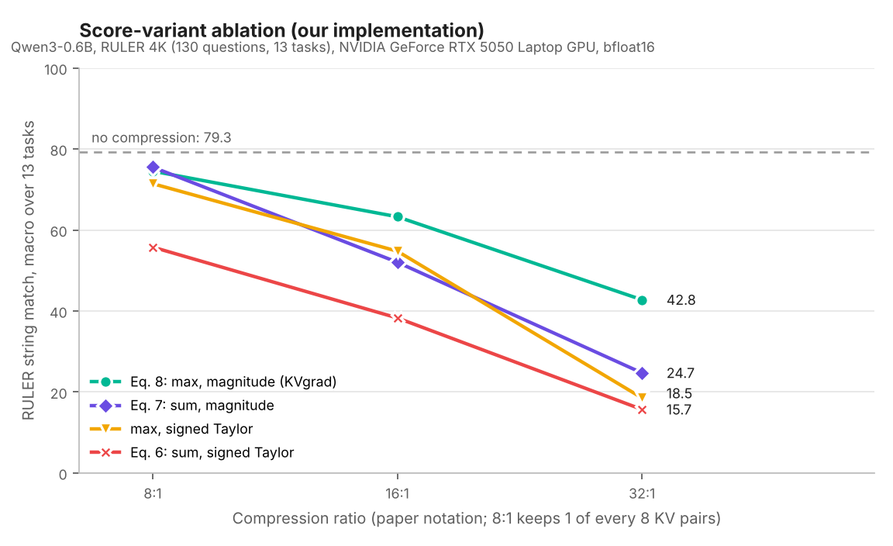

# Paper implementation card: KVgrad: Query-Agnostic KV Cache Eviction via Gradient-based Global Importance Scoring
 
- **Paper / OpenReview:** https://openreview.net/forum?id=cg1wTCJjjk (AdaptFM workshop at ICML 2026, by Kwak, Joo, Hwang, Byun and Moon from Seoul National University)
- **Primary module:** `Attention/` (KV cache and long context memory)
- **Secondary modules:** `Performance_Metrics/` (latency and memory protocol)
- **Team Members:** Mathangi Venkatraman Srinivasan, 230121037 (mathangiVS); Sanjay G, 230121049 (sanjayganeshprabu); Venkat Sai Teja Kalluri, 230121032 (teja123git); Vipul Sharma, 230103117 (Vipulsoc); Kondapi Venkata Dhruv, 230122024 (kvdhruv)
- **Tracking issue:** krsnoki/DA4022#8
- **Status:** `partial-reproduction`. We used one model, a subset of RULER 4K and compression from 2:1 up to 32:1. The main claim and the trend of the ablation were reproduced.
- **Upstream code / licence:** NVIDIA kvpress, https://github.com/NVIDIA/kvpress, Apache-2.0. Version `0.5.5` already includes `KVgradPress` (`kvpress/presses/kvgrad_press.py`), which implements the final score of the paper, Eq. (8). The intermediate scores used in the paper's ablation, Eqs. (6) and (7), are not in kvpress. We could not find a separate code release from the authors.
- **Backbone IDs:** `Qwen/Qwen3-0.6B`, Hugging Face revision `c1899de289a04d12100db370d81485cdf75e47ca` (pinned in the config)
- **Dataset IDs and split:** `simonjegou/ruler`, `data_dir=4096`, split `test`. This is RULER as packaged by kvpress: 13 tasks with 500 examples each, and contexts of about 4K tokens. We draw a stratified sample from each task with seed 42.
- **Hardware:** The main results were run on one NVIDIA GeForce RTX 5050 Laptop GPU (8 GB), driver 592.27, Windows 11, in **bfloat16**. The dry run was on an NVIDIA T4 in Google Colab, in fp32. Attention uses `sdpa`, since KVzip and KVgrad reject `eager`. We did not use FlashAttention-2.
## Research summary
 
### Problem
Long context inference is limited by memory bandwidth, because every generated token has to read the whole
key value (KV) cache. Query agnostic eviction removes cache entries once, looking only at the context, so the
compressed cache can be reused for any question asked later. The existing query agnostic scores (KVzip and
KVzip+) judge an entry only by how much it adds to the attention output **in its own layer**. They ignore how
that contribution travels through the later layers to the final representation of the model.
 
### Method
Like KVzip, KVgrad appends the prompt "Repeat the previous context:" followed by a copy of the context, and
uses these replay tokens $`p \in P`$ as probes. Let $`A^{\ell}_{p,c}`$ be the attention from probe $`p`$ to cache
entry $`c`$ at layer $`\ell`$, $`v^{\ell}_{c}`$ its value vector, $`W^{\ell}_{O}`$ the output projection and
$`a^{\ell}_{p} = \sum_{t} A^{\ell}_{p,t}\, v^{\ell}_{t} W^{\ell}_{O}`$ the attention output. The scores we compare in
this project are:
 
| Score | Definition | Paper |
|---|---|---|
| KVzip | $`S_{\ell,c} = \max_{p} A^{\ell}_{p,c}`$ | Eq. (3) |
| KVzip+ | $`S_{\ell,c} = \max_{p} A^{\ell}_{p,c}\, \lVert v^{\ell}_{c} W^{\ell}_{O}\rVert_2 \,/\, \lVert x^{\ell}_{p}\rVert_2`$ | Eq. (4) |
| First order Taylor | $`\sum_{p} A^{\ell}_{p,c}\,\big(v^{\ell}_{c} W^{\ell}_{O}\big)\cdot \nabla_{a^{\ell}_{p}}\Phi`$ | Eq. (6) |
| Magnitude aware bound | $`\lvert T^{\ell}_{p,c}\rvert \le A^{\ell}_{p,c}\,\lVert v^{\ell}_{c} W^{\ell}_{O}\rVert_2\,\lVert \nabla_{a^{\ell}_{p}}\Phi\rVert_2`$ | Eq. (7) |
| **KVgrad** | $`S_{\ell,c} = \max_{p}\, A^{\ell}_{p,c}\,\lVert v^{\ell}_{c} W^{\ell}_{O}\rVert_2\,\lVert \nabla_{a^{\ell}_{p}}\Phi\rVert_2`$ | **Eq. (8)** |
 
Here $`\Phi = \sum_{p} \lVert x^{L+1}_{p} \rVert_2^2`$ summarises the final hidden states, so the gradient
$`\nabla_{a^{\ell}_{p}}\Phi`$ (one backward pass) tells us how much the output depends on the attention output of
layer $`\ell`$ at probe $`p`$. Eq. (6) is the first order estimate of what happens if $`v^{\ell}_{c}`$ is removed.
Eq. (7) keeps only the magnitudes, because the raw gradient directions are noisy. Eq. (8) takes the max over
probes instead of the sum, so that an entry which matters to just one probe is not averaged away. Finally, the
lowest scoring fraction of entries (`compression_ratio`) is evicted across all layers and heads.
 
### Expected behaviour
 
The paper reports a score variant ablation for Qwen3-0.6B in appendix Table 4 (RULER, 10% of the
examples, string match):
 
| Variant | 8:1 | 16:1 | 32:1 |
|---|---:|---:|---:|
| `taylor_sum`, Eq. (6) | 73.15 | 54.51 | 24.37 |
| `taylor_max` | 72.24 | 55.83 | 24.45 |
| `bound_sum`, Eq. (7) summed | 72.33 | 55.96 | 36.32 |
| `bound_max`, Eq. (8) KVgrad | 69.66 | 57.21 | 40.20 |
 
For this small model the four variants are close at 8:1 and only separate at 16:1 and 32:1, where the
magnitude aware max (KVgrad) does best. That is why we run the ablation at 8:1, 16:1 and 32:1.
 
Main comparison: RULER string match reported in the paper for Qwen3-0.6B. The paper only gives per task values
in appendix Table 7, so **we computed the macro average over the 13 tasks ourselves**.
 
| Compression | No press | KVzip | KVzip+ | KVgrad |
|---|---:|---:|---:|---:|
| none | 78.2 | | | |
| 2:1 (`compression_ratio=0.5`) | | 78.0 | 78.1 | 78.1 |
| 4:1 (`0.75`) | | 68.5 | 72.7 | 77.1 |
| 8:1 (`0.875`) | | 55.6 | 60.1 | 72.2 |
 
Cost: KVgrad needs one extra forward and backward pass over the replayed context. kvpress estimates this at
3 to 4 times the prefill cost, compared with 2 to 3 times for KVzip. The paper also proposes a trainable MLP
surrogate, KVgrad (MLP), that removes this cost at inference time, but we did not implement it.
 
## Implementation
 
- **Input contract:** a RULER example (`context`, `question`, `answer_prefix`, `max_new_tokens`), batch size 1, with contexts of 3.4K to 4K tokens.
- **Output contract:** the generated answer string, plus latency per example (total, prefill with compression, and decode), peak GPU memory and input/output token counts. Each configuration writes a `metrics.json`, and all of them go into a `summary.csv` that follows the schema in `Performance_Metrics/README_metrics.md`.
- **Configuration:** `Attention/experiments/kvgrad/configs/ruler4k_qwen3_0.6b.yaml` for the baselines (ratios 0.5, 0.75 and 0.875) and `configs/ruler4k_qwen3_0.6b_ablation.yaml` for the score variants (0.875, 0.9375 and 0.96875). Both use 10 examples per task and seed 42. For the main runs we override `dtype` with `--dtype bfloat16`.
- **Reproduction commands** (run from `Attention/experiments/kvgrad/`, with the same output folder so that both runs use the same sampled rows):
  `python run_ruler.py --config configs/ruler4k_qwen3_0.6b.yaml --dtype bfloat16 --output_dir <dir>`
  `python run_ruler.py --config configs/ruler4k_qwen3_0.6b_ablation.yaml --dtype bfloat16 --output_dir <dir>`
  `python make_plots.py --results <dir>` (figures and the per task table)
- **Own implementation:** [`Attention/methods/context_compression/kvgrad/`](../../methods/context_compression/kvgrad/README.md).
  `scores.py` computes the four score variants from the paper's ablation (Eq. 6, Eq. 7 summed, the max Taylor
  score and Eq. 8) from the replay quantities. `press.py` (`KVgradVariantsPress`) plugs them into the replay and
  eviction code of kvpress. It can optionally cache the scores, so a single replay is enough for all variants and
  ratios. The names used in the benchmark are `kvgrad_taylor_sum`, `kvgrad_taylor_max`, `kvgrad_bound_sum` and
  `kvgrad_bound_max`.
- **Ablation configuration:** `configs/ruler4k_qwen3_0.6b_ablation.yaml` (the four variants at 8:1, 16:1 and 32:1).
- **Tests:** `python -m pytest Attention/tests -q` runs 12 tests on CPU with a tiny random Qwen3 model and no downloads. They check that:
  - for Eq. (6), the Taylor terms summed over probes and heads equal $`v \cdot \nabla_v \Phi`$ computed by autograd (float64, rtol 1e-10);
  - for Eq. (7), the magnitude bound holds for every probe and entry;
  - our `bound_max` gives the same scores as kvpress's `KVgradPress` (rtol 1e-5, atol 1e-7) and evicts exactly the same KV pairs, with one replay chunk and with several, and gives identical answers when run through `run_ruler.py`;
  - cached scores evict exactly what a fresh press evicts, for every variant and ratio;
  - the benchmark script runs end to end for all presses, writes the right output schema, scores correctly and can resume.
## Results
 
**Main runs:** RTX 5050 Laptop GPU, bfloat16, Qwen3-0.6B (`c1899de`), RULER 4K, using **130 examples (10 per task
over 13 tasks, seed 42) with the same rows for every configuration**. Batch size is 1, each configuration gets one
untimed warm up call, and timing is CUDA synchronised and covers the full pipeline call (tokenisation, prefill,
scoring and eviction, decoding).
The machine readable rows (one per configuration, in the schema of `Performance_Metrics/README_metrics.md`) are in
[`results_rtx5050_bf16/summary.csv`](results_rtx5050_bf16/summary.csv). Per task scores are in
[`results_rtx5050_bf16/per_task_scores.csv`](results_rtx5050_bf16/per_task_scores.csv), the environment is in
[`results_rtx5050_bf16/env.json`](results_rtx5050_bf16/env.json) and the sampled rows are in
[`results_rtx5050_bf16/samples_10pertask_seed42.csv`](results_rtx5050_bf16/samples_10pertask_seed42.csv).
 
### Quality: KVgrad vs. baselines
 
RULER string match, macro average over the 13 tasks. "Paper" is the macro average of appendix Table 7, which we
computed (all 6,500 examples, RTX A5000). "Local" is our run in this repository (130 examples).
 
| Compression | Source | No press | KVzip | KVzip+ | KVgrad |
|---|---|---:|---:|---:|---:|
| none | Paper / **Local** | 78.2 / **79.3** | | | |
| 2:1 | Paper / **Local** | | 78.0 / **79.3** | 78.1 / **79.0** | 78.1 / **79.8** |
| 4:1 | Paper / **Local** | | 68.5 / **71.4** | 72.7 / **75.2** | 77.1 / **79.8** |
| 8:1 | Paper / **Local** | | 55.6 / **61.4** | 60.1 / **63.2** | 72.2 / **75.1** |
 

 
This result was reproduced. KVgrad matches the no compression accuracy at 2:1 and 4:1 and loses only 4.2 points
at 8:1, while KVzip and KVzip+ lose 17.9 and 16.1 points. Our absolute numbers differ from the paper's by 2 to 6
points, which is within what 130 examples (10 per task) can resolve.
 
### Quality: score variant ablation (our implementation)
 
| Variant | Design choices | 8:1 Paper / **Local** | 16:1 Paper / **Local** | 32:1 Paper / **Local** |
|---|---|---:|---:|---:|
| `bound_max`, Eq. (8) KVgrad | max over probes and magnitude aware | 69.66 / **74.53** | 57.21 / **63.27** | 40.20 / **42.77** |
| `bound_sum`, Eq. (7) summed | magnitude aware only | 72.33 / **75.53** | 55.96 / **52.04** | 36.32 / **24.71** |
| `taylor_max` | max over probes only | 72.24 / **71.44** | 55.83 / **54.77** | 24.45 / **18.54** |
| `taylor_sum`, Eq. (6) | neither | 73.15 / **55.77** | 54.51 / **38.28** | 24.37 / **15.69** |
 
"Paper" is appendix Table 4 (Qwen3-0.6B, 10% of RULER). Our no compression reference is 79.3.
 

 
What we reproduced: at high compression (16:1 and 32:1) the full KVgrad score is clearly the best, and using both
design choices together beats using either one alone, as in the paper. At 8:1 the two magnitude aware variants
are within one point of each other (in the paper, all four are within 3.5 points).
 
What we did not reproduce: our first order Taylor score (Eq. 6) is much weaker at 8:1 (55.8 against 73.2). Like
kvpress, we reduce the per query head scores to the KV head by taking the max over the GQA group, and we evict
the lowest *signed* scores. The paper does not say how it combines GQA heads or how it handles the sign for this
variant, so we think this aggregation is the most likely cause. We have left it as an open question.
 
Our Eq. (8) compared with kvpress's KVgrad on the same 130 rows at 8:1: 74.53 against 75.09. 123 of the 130
answers are identical, and the other 7 mostly differ in formatting (`fwe`, `vt`, `niah_multivalue`). In float32
our scores and evictions are identical to kvpress's (tested with explicit tolerances). In bfloat16 on the GPU,
rounding and non deterministic kernels can flip near ties between scores. We did not repeat the runs, so we have
not measured how much results vary from run to run.
 
### Latency and memory
 
All values are medians per question (130 questions). "Eviction only" means our variant presses running on cached
scores (11 configurations), which covers everything kvpress does for an evicting press except the scoring itself.
 
| Configuration | Prefill + scoring/eviction | Decode | Total median / p95 | Peak memory allocated |
|---|---:|---:|---:|---:|
| No compression | 0.76 s | 1.06 s | 1.86 / 4.55 s | 2,194 MB |
| KVzip, 8:1 | 4.32 s | 1.13 s | 5.56 / 8.31 s | 2,871 MB |
| KVzip+, 8:1 | 4.66 s | 1.18 s | 5.97 / 8.80 s | 2,871 MB |
| KVgrad, 8:1 | 5.67 s | 1.14 s | 7.05 / 10.86 s | 4,984 MB |
| Eviction only, scores cached | 2.81 s | 1.19 s | 3.98 s | 2,229 MB |
 

 
**Scoring cost.** We take the prefill with scoring and eviction time and subtract the "eviction only" control.
This gives about 1.5 s for KVzip (2.0 times the prefill), about 1.8 s for KVzip+ (2.4 times) and **about 2.9 s for
KVgrad (3.8 times the prefill, or 1.9 times KVzip)**. This agrees with kvpress's own estimates of 2 to 3 times the
prefill for KVzip and 3 to 4 times for KVgrad.
 
**Peak memory.** KVgrad needs 4,984 MB, compared with 2,871 MB for KVzip and 2,194 MB without compression. The
extra 2.1 GB or so over KVzip comes from the activations stored for the backward pass. The measured peak memory
does **not** change with the compression ratio, because kvpress masks evicted entries instead of freeing them.
 
**Theoretical KV cache size** (not measured). In bfloat16 the cache takes 112 KiB per token, which is 416 MB at
the median context length of 3,807 tokens. A backend that really evicted entries would keep 52 MB at 8:1 and 13 MB
at 32:1.
 
**Decoding.** Compression does not make decoding faster (1.13 to 1.19 s, against 1.06 s), because with masking
the attention still reads the full cache.
 
**Overhead from kvpress, not from the method.** Every KVzip and KVgrad call reloads the tokenizer with
`AutoTokenizer.from_pretrained`, which contacts Hugging Face when online. This is included in all the compressed
latencies above, and it accounts for most of the roughly 2 s gap between "eviction only" and no compression.
 
KVzip at 2:1 has an unusual latency (median 11.9 s, with decoding taking up to 30 s), while its other ratios take
around 5.5 s. The laptop was being used for other work during that configuration. Its quality is not affected,
but its latency should not be quoted.
 
### Dry run (T4, float32, 2 examples per task)
 
The earlier dry run on Colab (26 examples) showed the same ordering. At 8:1 KVgrad scored 76.0, KVzip 55.2,
KVzip+ 56.7 and no compression 76.9. KVgrad's peak memory was 9.2 GB in float32. Rows:
[`dryrun/summary_2pertask_seed42.csv`](dryrun/summary_2pertask_seed42.csv).
 
## Differences and limitations
 
- **Partial reproduction:** we used one model (Qwen3-0.6B, out of the paper's four), only RULER 4K (no LongBench), and 130 of the 6,500 examples (10 per task), so per task scores move in steps of 10 points.
- **Hardware and precision:** we ran on a laptop RTX 5050 with 8 GB in bfloat16. KVgrad in float32 needs about 9.2 GB and does not fit. The paper ran Qwen3-0.6B on an RTX A5000 and does not state its precision, so our absolute latencies cannot be compared with the paper's, and they include kvpress reloading the tokenizer on every call.
- **What is ours:** the score computation for all four variants, their press, the benchmark harness and the tests. The replay, hooks and eviction come from kvpress 0.5.5, and the baseline `kvgrad` rows use kvpress's `KVgradPress`.
- **Ablation latency:** every configuration after the first reuses cached scores, so its latency does not include scoring (this is flagged in `summary.csv`). The real latency of KVgrad is the baseline `kvgrad` row.
- **Memory:** kvpress masks evicted entries, so we could not measure any real memory saving. We report the theoretical size of the kept cache instead.
- **Eq. (6) variant:** it scores well below the paper's number (see above).
- **Single runs:** we did not repeat runs or compute confidence intervals, and bfloat16 GPU runs are not bit reproducible.
- **`commit` field:** `summary.csv` shows `686bd09-dirty` because Python had created a `__pycache__` folder that was not yet ignored. The code itself was unchanged, and the folder is now ignored.
- **Not reproduced:** the KVgrad (MLP) surrogate, the time to first token figure, larger models and LongBench.
- **Environment notes:** Python 3.13 on Colab needs the `standard-pipes` backport, because kvpress 0.5.5 pins `fire<0.7`. On the laptop a network drop crashed one run, since kvpress contacts Hugging Face on every call. Running it again resumed from where it stopped.
- **Energy:** not measured.
## Reproduction checklist
 
- [x] Exact paper link and version verified
- [x] Base model revision pinned (`c1899de289a04d12100db370d81485cdf75e47ca`). The dataset revision is not pinned (`simonjegou/ruler` at its latest version), but the sampled row ids are committed
- [x] Baseline runs on the same setup (same 130 rows, same settings, no press)
- [x] Tests and seed handling added (12 CPU tests, including a comparison with kvpress's reference implementation; seed 42; saved sample ids)
- [x] Resource and quality metrics reported (latency split into prefill and decode, median and p95, peak memory and quality; energy not measured)
- [x] Licence and data terms checked (kvpress is Apache-2.0; RULER comes from kvpress's Hugging Face dataset; no weights or data are committed)
 
