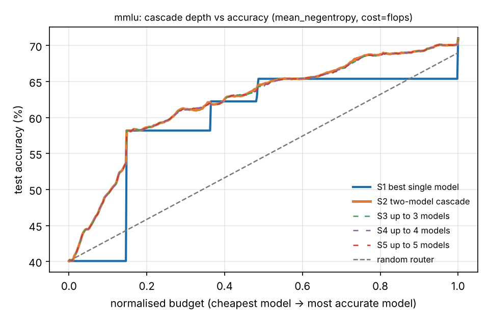

# AdaptFM-DA4022: Resource-Adaptive Deep Learning

This repository is a **research and engineering library** for implementing and comparing methods that make deep-learning inference adapt to hardware, latency, memory, energy, or quality constraints. AdaptFM workshop papers are used as research starting points; the repository is responsible for a common implementation interface, reproducibility, and comparable benchmarks.

> **Design rule:** backbones, data pipelines, adaptation methods, and metrics are separate concepts. Do not put all of them into a paper-specific folder.

## Results highlights: LLM cascades (Bouchard 2026)

The first paper implemented here is [*Is Escalation Worth It? A Decision-Theoretic Characterization of LLM Cascades*](https://arxiv.org/abs/2605.06350). A cascade answers each query with a cheap model first and passes it to a larger model only when the cheap model's confidence is low. **On open models, we reproduce the paper's main finding: a two-model cascade beats the best single model at the same compute budget, and cascades of three or more models add essentially nothing.**

**Setup:**
- **Models:** five open models (Qwen2.5-Instruct 0.5B, 1.5B, 3B and 7B, plus Phi-3.5-mini), all run on one RTX 4090.
- **Benchmarks:** 2,000 queries each from MMLU, TriviaQA and MATH (levels 3–5), using the paper's exact prompts.
- **Evaluation:** policies are chosen on a calibration half and scored on a held-out half, over 50 random splits and 500 cost budgets.
- **Status:** partial reproduction, because we use open models instead of the paper's API models, and a FLOP-based cost instead of API prices.

Test accuracy with the mean-negentropy confidence score and FLOP cost, averaged over all budgets. `S1` is the best single model within each budget; `S2` and `S3` are the best cascades of up to two and three models.

| Benchmark | Smallest model (0.5B) | Largest model (7B) | Best single model (`S1`) | Best 2-model cascade (`S2`) | Cascade gain `S2 − S1` | Paper's `S2 − S1` | Depth-3 gain `S3 − S2` |
|---|---:|---:|---:|---:|---:|---:|---:|
| MMLU | 40.1% | 71.0% | 59.7% | 62.3% | **+2.54 ± 0.46 pp** | +3.93 pp | −0.04 pp |
| TriviaQA | 0.1% | 51.2% | 36.8% | 40.6% | **+3.75 ± 0.37 pp** | +5.72 pp | −0.01 pp |
| MATH (L3–5) | 25.1% | 62.7% | 47.6% | 50.9% | **+3.34 ± 0.38 pp** | +2.80 pp | +0.002 pp |

Gains are the mean ± standard deviation over the 50 splits.

**Key findings:**
1. **Two-model cascades pay off.** Across 7 confidence scores, 3 benchmarks and 2 cost measures, the best two-model cascade beats the best single model by **+1.7 to +6.1 pp**. The paper reports +2.8 to +5.7 pp on these three benchmarks.
2. **Going deeper does not.** Allowing three, four or five models never beats the best two-model cascade by more than 0.002 pp. It is no better, or worse, in **122 of 126** comparisons. In the paper, the depth-3 gain was negative in 38 of 45 cases.
3. **Part of the gain is just model mixing.** A random "confidence" score still gains +1.1 to +2.9 pp, because sending a fixed share of queries to the larger model already beats any single model at a mid-range budget. A real confidence score adds on top of that; on MMLU, for example, +2.54 pp against +1.57 pp for random.
4. **Saving compute is not the same as saving time.** In a live run at batch size 1 on MMLU (0.5B → 7B, 200 queries), the cascade at 75% budget reaches **58.5%** accuracy, against 57.5% for always using the 7B model, with 10% fewer FLOPs per query (3.02 vs 3.36 TFLOPs). But its median latency is **96 ms against 54 ms**, because the queries it escalates run through both models. On a single GPU, the 7B model answers short questions almost as fast as the 0.5B model.

**Caveat:** TriviaQA uses the paper's strict exact-match grading. The 0.5B model usually answers in a full sentence ("The element … is cesium."), so it scores almost 0%. All responses are saved, so they can be regraded without rerunning on a GPU.



**More detail:**
- [Full results and analysis](Adaptive_Stopping/README_adaptiveStopping.md#results)
- [Paper card](Adaptive_Stopping/methods/cascade_escalation/PAPER_CARD.md), covering method, differences from the paper and limitations
- [Raw tables, plots and run metadata](Adaptive_Stopping/experiments/cascade_escalation/results_rtx4090/)
- [Machine-readable result rows](Performance_Metrics/results/cascade_escalation.csv)
- To reproduce, follow the [GPU run and offline sweep instructions](Adaptive_Stopping/README_adaptiveStopping.md#reproduction).

## Repository map

| Path | Responsibility | Put here |
|---|---|---|
| `Backbones/` | Reusable baseline models | Supervised, self-supervised, generative-pretrained, and task-finetuned model wrappers/metadata |
| `Dataloaders/` | Dataset and batch construction | Train/eval/calibration splits, preprocessing, collators, deterministic sampling |
| `Quantization_and_Pruning/` | Model compression | PTQ/QAT, low-bit formats, weight/layer/token pruning, structured sparsity |
| `Attention/` | Attention and context efficiency | Efficient/sparse/linear attention, KV-related attention methods, token/context compression |
| `Mixture_of_Experts/` | Sparse and elastic experts | Expert routing, expert pruning, load balancing, MoE quantization and serving |
| `Adaptive_Stopping/` | Variable-depth/variable-compute inference | Early exit, learned stopping, adaptive reasoning budgets, confidence-based stopping |
| `LoRA/` | Parameter-efficient adaptation baseline | LoRA adapters, rank/target-module configs, merge/unmerge tests |
| `Performance_Metrics/` | Shared experiment protocol | Latency, throughput, memory, quality, energy, profiling and report schemas |
| `PAPER_INDEX.md` | Cross-repository paper map | Paper-to-module assignments and direct paper links |
| `templates/` | Contribution templates | Paper implementation card, model card, dataset card |

The module README files explain each module's scope and link relevant papers. Papers may appear in more than one module when methods genuinely cross boundaries; choose one **primary owner** for implementation and cross-link the other modules.

## Important terminology

- **Backbone**: the base network/architecture and its pretrained weights, such as ResNet, ViT, BERT, a decoder-only language model, or a vision-language model.
- **Pretraining regime**: how the base weights were learned. Use `supervised`, `self_supervised`, `unsupervised_legacy`, or `unknown`; record the actual objective rather than relying only on labels.
- **Task-finetuned model**: a backbone whose weights have also been tuned on a labelled or instruction-following task. Keep its parent backbone and fine-tuning dataset in metadata.
- **Adaptation method**: a method applied to or used with a backbone, e.g. quantization, pruning, LoRA, attention optimization, MoE routing, or early stopping.
- **Dataloader**: the code that turns a dataset/split into batches. Dataloaders do not belong inside a backbone or paper implementation.

In modern ML, many methods casually called “unsupervised” are more precisely **self-supervised** (e.g. masked-token or next-token prediction). Preserve that distinction in metadata.

## Quick start

The repository currently documents research modules; install requirements only for the module you are working on. Avoid one giant environment containing every optional CUDA/kernel package.

```bash
git clone <your-repository-url>
cd AdaptFM-DA4022
python -m venv .venv
source .venv/bin/activate             # Linux/macOS
python -m pip install --upgrade pip
```

Install PyTorch using the command recommended by the [official PyTorch selector](https://pytorch.org/get-started/locally/) for your OS, Python version, and CPU/CUDA setup. Then install module-specific dependencies as documented by that module. Do not assume a CUDA implementation will run on CPU or on a different GPU architecture.

Check local hardware before a benchmark:

```bash
python -c "import platform; print(platform.platform())"
python -c "import torch; print('torch', torch.__version__); print('cuda available', torch.cuda.is_available()); print('device count', torch.cuda.device_count())"
```

## Minimum standard for every implementation

1. **Name the paper and method version.** Link its paper and record any upstream code, license, or unavailable assets.
2. **Keep a baseline.** Run the same backbone, dataset split, input length/resolution, batch size, and evaluation settings without the method.
3. **Record configuration.** Save model ID/revision, dataset version/split, seeds, precision, batch size, input shapes, software versions, hardware, and all relevant method hyperparameters.
4. **Measure more than parameter count.** Report task quality plus runtime latency/throughput and peak memory. Report energy only when a real energy measurement and the measurement procedure are available.
5. **Test correctness.** Include a small CPU smoke test where feasible, shape/dtype tests, and deterministic/config validation.
6. **Be transparent.** Label results as `reproduced`, `partial`, `approximate`, or `not reproduced`. Do not present estimated latency or unmeasured energy as measured results.
7. **Respect licenses and data access rules.** Do not commit model weights, private data, dataset archives, API keys, or large generated artifacts. Supply download instructions and checksums where permitted.

## Paper implementation workflow

1. Select a paper from [`PAPER_INDEX.md`](PAPER_INDEX.md) and open an issue before coding.
2. Write down the expected input/output contract, required backbone(s), data needs, hardware assumptions, and baseline.
3. Add a paper card using [`templates/PAPER_IMPLEMENTATION_TEMPLATE.md`](templates/PAPER_IMPLEMENTATION_TEMPLATE.md).
4. Implement the method in the owning module; keep experiment-specific scripts/configs outside shared core utilities.
5. Add a minimal test and a reproduction command.
6. Add one row to the result schema in `Performance_Metrics/README_metrics.md` and include an unmodified baseline result.
7. Submit a PR that includes docs, config, tests, and limitations.

Suggested status labels: `proposed`, `reading`, `baseline-ready`, `implementing`, `tested`, `reproduced`, `partial-reproduction`, `blocked`.

## Proposed growth structure

```text
AdaptFM-DA4022/
├── README.md
├── PAPER_INDEX.md
├── Adaptive_Stopping/
├── Attention/
├── Backbones/
│   ├── Supervised/
│   ├── Self_Supervised/
│   ├── Generative_Pretrained/
│   └── Task_Finetuned/
├── Dataloaders/
│   ├── supervised/
│   ├── self_supervised/
│   ├── calibration/
│   ├── evaluation/
│   └── synthetic/
├── LoRA/
├── Mixture_of_Experts/
├── Performance_Metrics/
├── Quantization_and_Pruning/
└── templates/
```

Only create code directories when they have an owner and a concrete implementation. Empty scaffolding is not a contribution by itself.

## Source of paper list

The paper map is based on the [official AdaptFM accepted-paper list](https://adaptfm.gitlab.io/accepted-papers) and the workshop site ([AdaptFM: Resource-Adaptive Foundation Model Inference](https://adaptfm.gitlab.io/)). The categories in this repository are **our engineering classification**, not official workshop tracks. Paper relevance and reproducibility should be reviewed when a contributor starts work; acceptance does not imply that public code or checkpoints exist.
