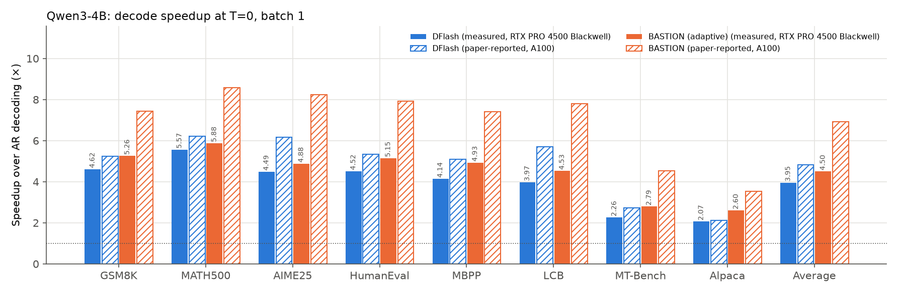
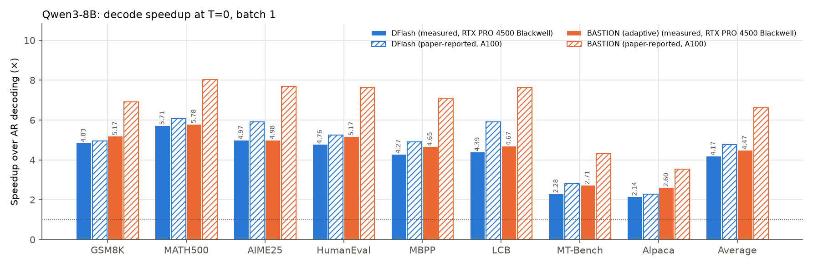
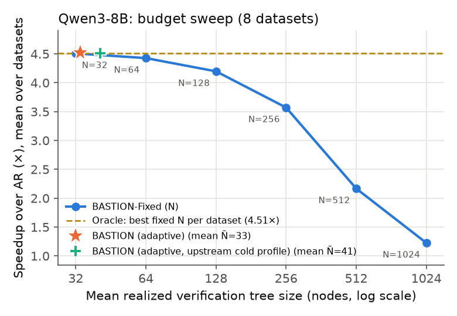

# BASTION reproduction

This folder reproduces *BASTION: Budget-Aware Speculative Decoding with Tree-structured Block Diffusion Drafting* (arXiv [2605.29727](https://arxiv.org/abs/2605.29727), [OpenReview](https://openreview.net/forum?id=uqeOxztSIS)) for DA4022. The official code is used for the method itself. This folder adds the experiment harness, the analysis, the tests and the write-up.

**Status: `partial-reproduction`.** On one RTX PRO 4500 Blackwell GPU with Qwen3-4B and Qwen3-8B at temperature 0:
- **Reproduced:** the paper's qualitative claims. BASTION is faster than DFlash and accepts more tokens per step on every benchmark. Its adaptive budget matches the best fixed budget, and calibration removes most of the latency model's error.
- **Not reproduced:** the size of the speedups. BASTION reaches 4.50× / 4.47× over plain decoding here, against 6.93× / 6.61× in the paper on an A100.

| Document | Contents |
|---|---|
| This README | Overview: the paper, how the experiments were run, results, limitations, how to rerun |
| [`REPORT.md`](REPORT.md) | Full report: per-benchmark tables, bootstrap intervals, diagnostics, every decision taken |
| [`PAPER_CARD.md`](PAPER_CARD.md) | DA4022 paper card (research summary, input/output contract, results, status) |
| [`results/`](results/) | All tables, CSV/JSON outputs and figures |

---

## 1. The paper in brief

**Speculative decoding** speeds up text generation without changing the output. A small, cheap *drafter* guesses several future tokens. The large *target* model then checks all of them in a single forward pass and keeps the longest prefix it agrees with. Because one target pass can accept several tokens, generation gets faster while the output stays identical to normal (autoregressive, "AR") decoding.

**The problem BASTION addresses.** [DFlash](https://github.com/z-lab/dflash) drafters are small *block-diffusion* models. They propose a whole block of 16 tokens in one parallel pass, giving a separate probability distribution for each position. If only the single most likely token at each position is checked (a chain), the target often rejects early, because the drafter's top choices at different positions were not chosen together. Checking a *tree* of alternatives fixes this. A bigger tree, though, makes the target's checking pass slower. The best tree size depends on the prompt, the context length, the model and the GPU, so a fixed tree shape or size wastes speed.

**The method.** At each decoding step BASTION:
1. **Estimates acceptance cheaply.** Every candidate node gets a score: the product of the drafter's probabilities along its path. The sum of these scores over a tree serves as a stand-in for how many tokens the target will accept.
2. **Grows the best tree for every size.** Nodes are added greedily in order of score, always keeping the tree connected to its root. For every size N this gives the best-scoring tree, and each additional node adds less than the one before.
3. **Predicts the cost of checking the tree.** A roofline model estimates how long the target's checking pass takes for N nodes at the current context length. It uses the GPU's memory bandwidth and peak compute and the model's size, plus a one-off per-GPU, per-model linear calibration on measured latencies.
4. **Stops at the best size.** As the tree grows, it tracks estimated speedup (expected accepted tokens ÷ predicted cost per step) and stops as soon as that estimate starts to fall. The chosen tree is checked in one target pass with a tree-shaped attention mask, so the output is unchanged.

The method needs no training and no tuning beyond the one-off calibration.

**The paper's main claims (A100 80 GB, temperature 0).**
- On 8 benchmarks, BASTION raises the average speedup over AR from 4.83× (DFlash) to **6.93×** on Qwen3-4B, and from 4.76× to **6.61×** on Qwen3-8B.
- The average number of accepted tokens per step (τ) rises from about 6.2 to about 8.5.
- The trees it picks average 202 nodes (Qwen3-4B) and 139 nodes (Qwen3-8B).
- The adaptive budget tracks the best fixed budget per benchmark, and trees that are too big slow decoding down.
- Calibration cuts the latency model's error by 87–92%.
- The output is lossless.

---

## 2. How the experiments were run

### Setup

| | This reproduction | Paper |
|---|---|---|
| GPU | 1× NVIDIA RTX PRO 4500 Blackwell, 32 GB (shared workstation) | A100 80 GB (Table 1) |
| Target models | Qwen3-4B, Qwen3-8B (non-thinking mode) | Qwen3-4B, Qwen3-8B, Llama-3.1-8B-Instruct |
| Drafters | z-lab/Qwen3-4B-DFlash-b16, z-lab/Qwen3-8B-DFlash-b16 (block size 16) | same |
| Precision, batch, temperature | bf16, batch 1, T=0 | bf16, batch 1, T=0 and T=1 |
| Software | Python 3.11, torch 2.8.0+cu128, transformers 4.57.1; PyTorch's built-in attention (SDPA) for every mode | transformers backend; FlashAttention-2 for AR/DFlash when installed |
| Method code | Official repository, pinned at commit `1989b80` and unmodified (`upstream/`) | — |

Model revisions are pinned in [`REPORT.md` §3](REPORT.md#3-setup). Three things had to be added around the official code to run it here, all without editing it:
- **GPU registration.** The official cost model only knows six GPUs. This GPU is registered at runtime as `b4500`, with 896 GB/s bandwidth and an *assumed* 202 TFLOPS of bf16 compute (a matrix multiply measured 177).
- **Calibration memory fix.** On Qwen3-8B the official calibration ran out of memory on 32 GB, because an untimed setup pass kept gradient information. That pass now runs with gradients off; the timed passes are unchanged.
- **LiveCodeBench loader.** Current `datasets` versions refuse its loading script, so it is rebuilt from pinned data files.

### Benchmarks and protocol

- **Benchmarks:** the 8 from the paper's Table 1: GSM8K, MATH-500, AIME25 (math); HumanEval, MBPP, LiveCodeBench release_v2 (code); MT-Bench (2 turns), Alpaca (chat).
- **Prompts:** 64 per benchmark, chosen exactly as the official code does (seeded shuffle, first 64); all 30 AIME25 problems; 40 MT-Bench questions × 2 turns. That is 494 generations per model and mode.
- **Generation:** up to 2048 new tokens. For each prompt, all three modes (AR, DFlash, BASTION) run back to back in the same process, each after one untimed warm-up pass.
- **Metrics,** computed as the official code does:
  - **Speedup** = mean time per output token of AR ÷ that of the method, over the same prompts. Prefill (the first token) is excluded.
  - **τ** = average number of tokens accepted per target pass.
  - **"Average"** = unweighted mean over the 8 benchmarks.
  - 95% bootstrap intervals (prompts resampled within each benchmark) are reported for the key ratios.

### Experiments

| ID | Experiment | Paper reference |
|---|---|---|
| E1 | Speedup and τ for AR / DFlash / BASTION, both models, 8 benchmarks | Table 1 (T=0 half) |
| E3 | Lossless check: does the speculative output equal AR token for token? | "lossless" claim |
| E4 | Budget sweep on Qwen3-8B: fixed tree sizes N = 32…1024 vs adaptive, 16 prompts per benchmark | Fig. 4 |
| E5 | Accuracy of the latency model, before and after calibration | Fig. 9a |
| Extra | Math accuracy of each mode (quality check) | not in paper |
| Extra | fp32 vs bf16 precision check (Qwen3-4B, 8 prompts), to explain E3 | not in paper |

Not run: temperature 1, Llama-3.1-8B (gated model, no access token), the EAGLE-3 baseline, LongBench, the H100 table and the ablations.

GPU time: E1 took about 1.5 h for Qwen3-4B and 2.3 h for Qwen3-8B, and E4 took 1.5 h.

---

## 3. Results

### Main result (E1)

| | Qwen3-4B here | Qwen3-4B paper | Qwen3-8B here | Qwen3-8B paper |
|---|---:|---:|---:|---:|
| DFlash speedup over AR | 3.95× | 4.83× | 4.17× | 4.76× |
| **BASTION speedup over AR** | **4.50×** | 6.93× | **4.47×** | 6.61× |
| BASTION ÷ DFlash | 1.139 | 1.435 | 1.071 | 1.389 |
| DFlash τ | 5.69 | 6.23 | 5.76 | 6.24 |
| BASTION τ | 7.58 | 8.56 | 7.03 | 8.48 |
| Average BASTION tree size | 60 nodes | 202 | 33 nodes | 139 |




*Solid bars: measured here. Hatched bars: paper Table 1 (A100). Per-benchmark tables are in [`results/e1_table1.md`](results/e1_table1.md) and [`results/e1_paper_comparison.md`](results/e1_paper_comparison.md).*

- **BASTION beats DFlash** in speedup and τ on all 16 model–benchmark pairs. On Qwen3-8B MATH-500 and AIME25 the speedup difference is within noise.
- **The lead is much smaller than in the paper:** +14% / +7% instead of +43% / +39%.
- **Absolute speedups are about 65–68% of the paper's for BASTION** and 82–88% for DFlash.

### Budget sweep (E4, Qwen3-8B)

| Configuration | Speedup | τ |
|---|---:|---:|
| Fixed N = 32 | 4.51× | 7.03 |
| Fixed N = 64 | 4.43× | 7.52 |
| Fixed N = 128 | 4.20× | 7.96 |
| Fixed N = 256 | 3.57× | 8.19 |
| Fixed N = 512 | 2.17× | 8.73 |
| Fixed N = 1024 | 1.23× | 8.99 |
| **Adaptive (BASTION)** | **4.52×** | 7.15 |
| Best fixed N per benchmark ("oracle") | 4.51× | — |
| DFlash (chain of 16) | 4.20× | — |



- **The adaptive controller matches the oracle** (ratio 1.002, 95% CI [0.993, 1.011]).
- **Oversized trees hurt badly:** at N = 1024, MT-Bench and Alpaca become slower than plain decoding.
- **Not reproduced:** the paper's sharply peaked curve with its best size in the middle. Here the best size is the smallest one tested.

### Latency model (E5)

| | Error before calibration | Error after | Reduction | Paper |
|---|---:|---:|---:|---:|
| Qwen3-4B | 19.3 ms | 3.3 ms | 83% | 29.2 → 2.3 ms (92%) |
| Qwen3-8B | 28.7 ms | 4.3 ms | 85% | 30.6 → 3.1 ms (90%) |

Errors are RMSE at context lengths 64, 256 and 1024.

- **Partly reproduced.** At the tree sizes BASTION actually picked during E1, the controller's prediction error was 1.7 / 1.9 ms.
- **Steps the linear fit can't follow.** The measured latency jumps around 256–272 and 384–400 tokens being checked, which plausibly explains the higher residual error after calibration.

### Losslessness and quality (E3 + extras)

- **In bf16, only 30–35% of speculative outputs equal AR exactly,** at the same rate for DFlash and BASTION.
- **The precision check explains why.**
  - In fp32, both methods match AR on **8/8** prompts.
  - In bf16, every mismatch starts where the target's top two candidate tokens are tied to within bf16 rounding (logit gap ≤ 0.25).
  - Plain AR decoding itself changes between bf16 and fp32 on 6 of 8 prompts.
  - So the mismatches come from bf16 arithmetic, not from the speculative methods. The sample is small (8 prompts).
- **Answer quality is unaffected.** Correct math answers out of 158 were 109 / 107 / 107 (AR / DFlash / BASTION) on Qwen3-4B and 111 / 112 / 111 on Qwen3-8B.

### Why the speedups are lower than in the paper

Speedup is roughly τ ÷ (cost of one speculative step in AR steps). The drafter behaves as in the paper: DFlash's τ on math matches (MATH-500 8.19 vs 8.12). The difference is the cost side:
- **Checking a tree is relatively expensive on this setup.** Checking a 32–64-node tree costs 1.3–1.4 AR steps here. The paper's numbers imply that checking ~140–200 nodes costs only ~1.25–1.29 AR steps on the A100. For example, on Qwen3-4B, checking 16 tokens takes 16.1 ms and 256 tokens 26.1 ms, while one AR step takes 13.7 ms.
- **So the controller correctly picks small trees.** E4 confirms that larger trees are slower here. Small trees give a smaller τ gain, which shrinks BASTION's lead over DFlash.
- **The root cause is not established.** GPU specs alone predict the opposite, and the paper's results on the A6000, a weaker GPU than ours, are still better than ours. The checking pass runs 1.35–1.75× slower than the roofline predicts.
  - Likely contributors: SDPA attention with an explicit tree mask on the new Blackwell architecture, and per-pass overhead in Hugging Face transformers. Neither was isolated.

Details: [`REPORT.md` §5.2 and §6](REPORT.md#52-where-the-margin-goes-tree-size-and-cycle-cost).

---

## 4. Limitations

- **Different GPU.** Only one GPU type was used, and not the paper's. Absolute speedups are not comparable; the qualitative claims and ratios are what this reproduction tests.
- **Partial coverage.** Not covered: the temperature-1 half of Table 1, Llama-3.1-8B, EAGLE-3, LongBench, the H100 results and the ablations (beam search, online calibration).
- **Sample caps.** 64 prompts per benchmark (16 in E4) instead of the full sets. The paper does not state its counts, so the prompt sets may differ from the paper's, which may explain the lower DFlash τ on MT-Bench and LiveCodeBench. Bootstrap uncertainty on the averages is ±0.07–0.10×, far smaller than the gap to the paper (2.1–2.4×).
- **One timing run per configuration.** One repeat was done: adaptive Qwen3-8B on the E4 prompts. It reproduced E1 bit for bit, with per-prompt timings within ±1%.
- **Changed controller profile.** The official code measures the controller's fixed costs "cold". On this machine that inflated them up to 180× and produced oversized, slower trees. The main runs use a warm measurement instead. E4 shows the choice makes no speed difference on Qwen3-8B; on Qwen3-4B it was only checked in a 2-prompt pilot.
- **No FlashAttention.** It was not installed, so AR and DFlash also used SDPA. The official code uses FlashAttention-2 for them when available. It is not known whether this raises or lowers the ratios.
- **Assumed GPU compute peak** (202 TFLOPS). It only affects the uncalibrated latency model.
- **Small precision check** (8 prompts, 1 model, 256 tokens). It shows that bf16 rounding is enough to explain the mismatches with AR, not that it explains every one.
- **Simple math scorer.** It does not test symbolic equivalence, and AIME25 accuracy mostly reflects answers cut off at 2048 tokens.
- **Shared machine and an interrupted run.** Other users' GPU activity was not logged, though AR timing spread was low (±0.2–0.3 ms). The Qwen3-4B E1 run was interrupted and resumed; timings from the two halves agree within 0.08 ms.
- **Root cause of the gap unidentified.** No profiling of the checking pass was done, so the mechanism (expensive checking, hence small trees) is measured but its cause is not.

---

## 5. How to rerun

### Environment (once)

Run these from the DA4022 repository root. Only the BASTION submodule is needed; its nested `sglang` submodule is not.

```bash
git submodule update --init Speculative_Decoding/BASTION/upstream
cd Speculative_Decoding/BASTION
uv venv --python 3.11 .venv
uv pip install --python .venv/bin/python torch==2.8.0 --index-url https://download.pytorch.org/whl/cu128
uv pip install --python .venv/bin/python -e "upstream[transformers]" pytest matplotlib pandas pyyaml
```

The models download from Hugging Face on first use; the revisions used are listed in [`REPORT.md` §3](REPORT.md#3-setup). Blackwell GPUs (sm_120) need torch built for CUDA 12.8 or newer.

### Commands

Run these from this folder. Calibration and timing need an idle GPU.

```bash
CUDA_VISIBLE_DEVICES="" .venv/bin/python -m pytest tests -q     # 115 CPU tests, no GPU or downloads

.venv/bin/python tools/prepare_lcb.py                           # LiveCodeBench prompt cache (once)
tools/setup_smoke.sh Qwen/Qwen3-4B z-lab/Qwen3-4B-DFlash-b16    # latency calibration + smoke test
tools/setup_smoke.sh Qwen/Qwen3-8B z-lab/Qwen3-8B-DFlash-b16
scripts/run_pilot.sh qwen3-4b                                   # optional: 2 prompts/benchmark
scripts/run_e1.sh qwen3-4b                                      # E1/E3 (resumable)
scripts/run_e1.sh qwen3-8b
scripts/run_sweep.sh qwen3-8b                                   # E4 (needs E1 Qwen3-8B first)
.venv/bin/python analysis/precision_check.py --model Qwen/Qwen3-4B \
    --draft-model z-lab/Qwen3-4B-DFlash-b16 --gpu-key b4500 \
    --out-dir results/precision_check_qwen3-4b                  # fp32 vs bf16 check
scripts/run_analysis.sh                                         # all tables and figures (CPU)
```

Raw per-prompt records go to `runs/`, which is git-ignored. Calibration caches go to `upstream/cache/`. Rerunning a script resumes from its existing records. Sample caps can be changed with environment variables, for example `MAX_SAMPLES=32 scripts/run_e1.sh qwen3-8b`.

---

## 6. Folder layout

| Path | Purpose |
|---|---|
| `upstream/` | Official BASTION code (git submodule, commit `1989b80`, unmodified) |
| `run_benchmark.py` | Experiment harness built on the official benchmark loop: several benchmarks per run, fixed or adaptive budgets, warm-up, resumable JSONL output |
| `repro_lib.py` | GPU registration, tree-size recording, sample selection identical to the official code, JSONL I/O |
| `tools/bastion_local.py` | Registers this GPU with the official cost model and applies the calibration memory fix |
| `tools/prepare_lcb.py` | Rebuilds the LiveCodeBench release_v2 prompts from pinned files |
| `tools/setup_smoke.sh` | Calibration and smoke test; refuses to start if the GPU is in use |
| `scripts/` | `run_pilot.sh`, `run_e1.sh`, `run_sweep.sh`, `run_analysis.sh` |
| `analysis/aggregate.py` | Speedup, τ and tree size per model, benchmark and method; DA4022 CSV; Table-1 markdown |
| `analysis/check_lossless.py` | E3: exact match and first-divergence statistics against AR |
| `analysis/e1_extras.py` | E1 vs paper per benchmark, tree-size distribution, bootstrap intervals, resume check |
| `analysis/sweep_extras.py` | E4: oracle, adaptive vs fixed-N ratios with bootstrap intervals, repeat-run check |
| `analysis/latency_model.py` | E5: uncalibrated vs calibrated latency model vs measured |
| `analysis/score_math.py` | Math answer accuracy (GSM8K, MATH-500, AIME25) |
| `analysis/precision_check.py` | fp32 vs bf16 check with logit margins at each divergence |
| `analysis/plots.py` | All figures |
| `tests/` | CPU-only pytest suite (synthetic data, tiny random models) |
| `results/` | Generated tables (`*.md`), machine-readable outputs (`*.csv`, `*.json`) and `figures/` |

Related entries elsewhere in DA4022:
- Model cards: [`Backbones/Generative_Pretrained/qwen3-4b.md`](../../Backbones/Generative_Pretrained/qwen3-4b.md) and [`qwen3-8b.md`](../../Backbones/Generative_Pretrained/qwen3-8b.md)
- Benchmark card: [`Dataloaders/evaluation/bastion_short_benchmarks.md`](../../Dataloaders/evaluation/bastion_short_benchmarks.md)
- Result rows: [`Performance_Metrics/README_metrics.md`](../../Performance_Metrics/README_metrics.md)

---

## 7. Implementation notes

These details matter when reading or extending the results.

- **Sample selection** matches the official `_limit_dataset` exactly: `random.seed(0)`, shuffle, keep the first k. The shuffle happens only when k is smaller than the dataset. Each record stores `orig_idx`, the problem's index in the official dataset order, and runs are matched on it. This is needed because AIME25 keeps its original order at cap 30 but is shuffled at cap 16.
- **A fixed budget N** is passed through the official `bastion_generate(min_tree_size=N, max_tree_size=N)`. With min = max = N, the stopping rule never fires and the tree has exactly N nodes. Every BASTION step logs its realized tree size.
- **Adaptive trees** use the official defaults: minimum 32, maximum 8192, top-K ≤ 128, return sizes rounded down to multiples of 32.
- **Controller profile (`--profile-mode`).**
  - `upstream`, the harness default, keeps the official cold measurement, cached in `upstream/cache/calibration_<gpu>_<model>.profile.json`.
  - `warm`, used by the scripts, runs the official profiler twice and keeps the second result, cached separately as `.profile.warm.json`.
  - The profile mode is part of the resume and aggregation key, so the two are never mixed.
- **Speedup** is computed only over records with an AR counterpart for the same model, benchmark, problem, turn and prompt hash.
- **MT-Bench turn 2** always uses the AR baseline's turn-1 answer as history, for every mode, as in the official code. The sweep reuses E1's AR answers (`--history-jsonl`).
- **Differences from the official script:**
  - one process and one GPU (no torchrun);
  - several benchmarks per process;
  - one warm-up pass per mode;
  - the warm profile option;
  - `--history-jsonl`.
