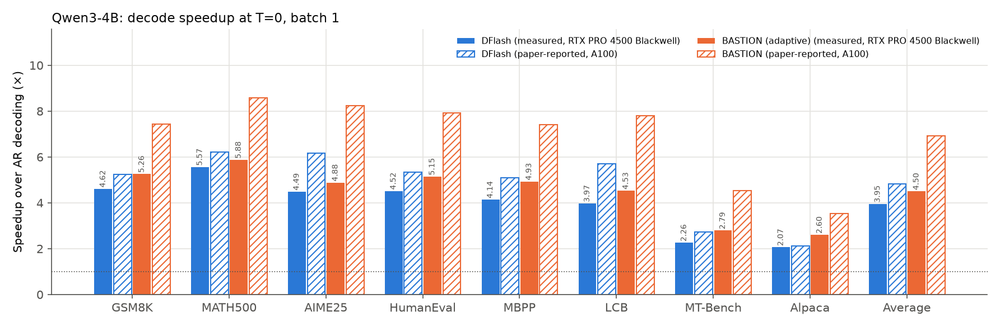
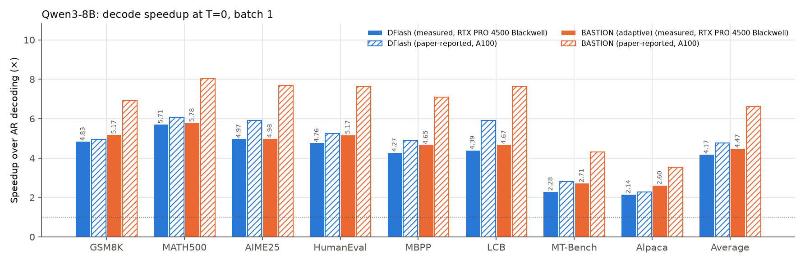
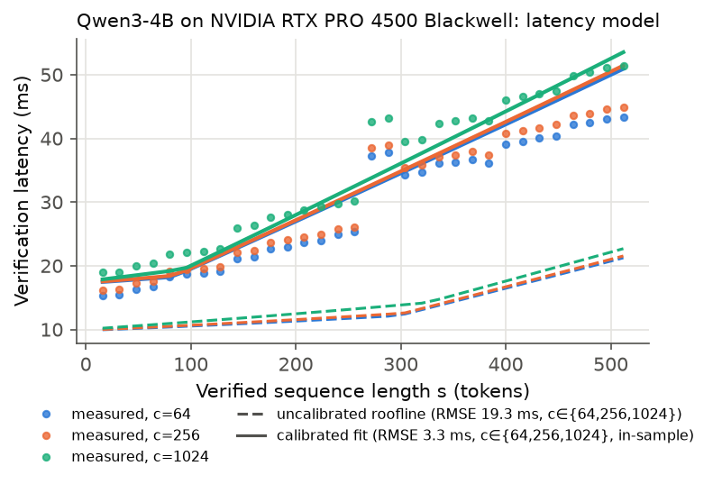
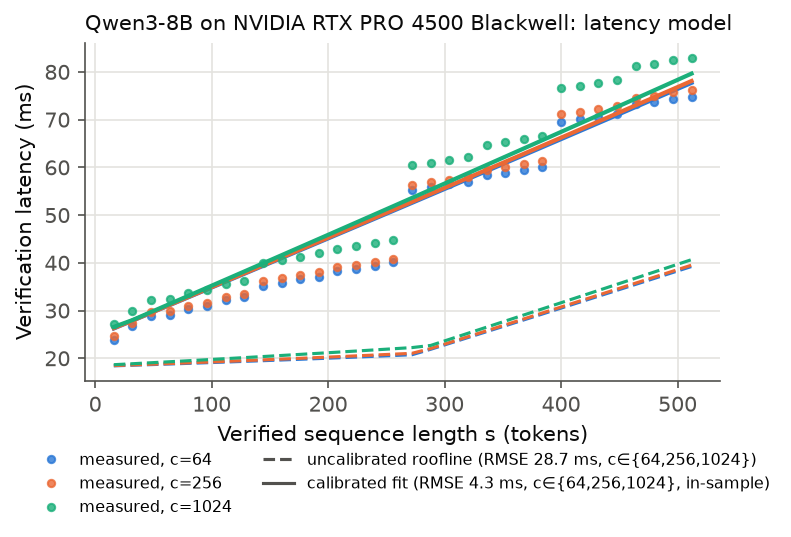
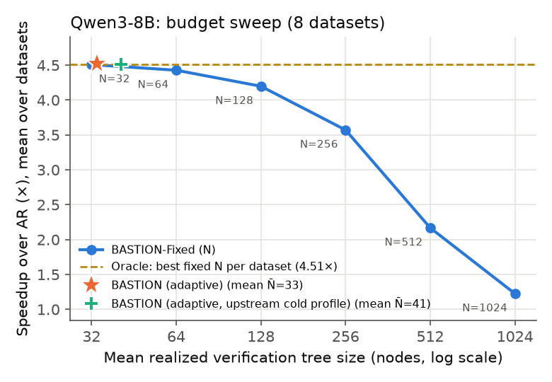
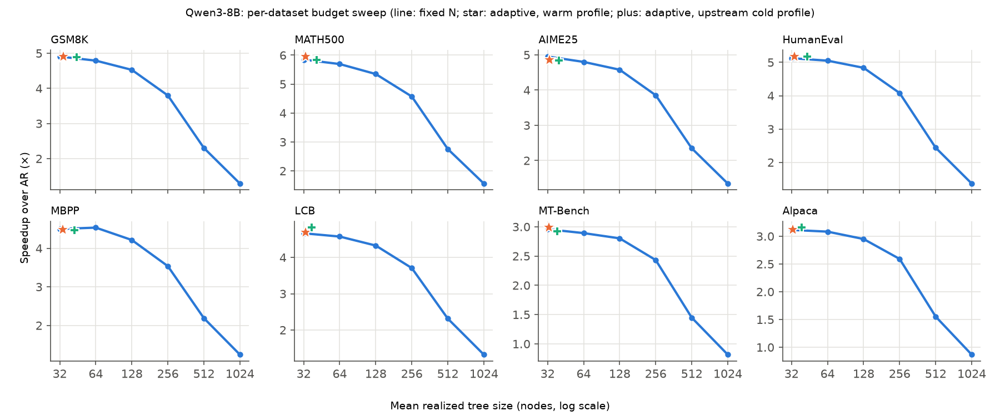

# BASTION reproduction report (DA4022)

**Paper:** *BASTION: Budget-Aware Speculative Decoding with Tree-structured Block Diffusion Drafting* (AdaptFM / ICML 2026; arXiv 2605.29727).
**Code:** official upstream (MIT), pinned at `1989b80`, unmodified. This folder adds the harness, analysis and tests.
**Status:** `partial-reproduction`. This report covers E1 (Table 1 at T=0), E3 (exact match vs AR), E4 (budget sweep), E5 (latency model), a math-accuracy check and an fp32/bf16 precision check.
**Hardware:** one NVIDIA RTX PRO 4500 Blackwell (32 GB). The paper used an A100 80 GB.

Numbers taken from the paper are labelled "paper". All other numbers were measured here and come from `runs/e1_qwen3-{4b,8b}.jsonl`, `runs/sweep_qwen3-8b.jsonl`, `results/precision_check_qwen3-4b/`, `upstream/cache/` and the scripts in `analysis/`. The outputs are in [`results/`](results/).

---

## 1. Summary of findings

| | Qwen3-4B local | Qwen3-4B paper (A100) | Qwen3-8B local | Qwen3-8B paper (A100) |
|---|---:|---:|---:|---:|
| DFlash average speedup over AR (8 benchmarks) | 3.95× | 4.83× | 4.17× | 4.76× |
| BASTION average speedup over AR | **4.50×** | 6.93× | **4.47×** | 6.61× |
| BASTION / DFlash (ratio of averages) | **1.139** | 1.435 | **1.071** | 1.389 |
| DFlash τ (AAL) | 5.69 | 6.23 | 5.76 | 6.24 |
| BASTION τ (AAL) | 7.58 | 8.56 | 7.03 | 8.48 |
| BASTION mean realized tree size N̄ | 60.1 | 202.0 (Fig. 9b) | 33.2 | 139.3 (Fig. 9b) |
| Exact match with AR at T=0 (DFlash / BASTION) | 34.8% / 33.4% | "lossless" | 30.2% / 31.0% | "lossless" |
| Latency-model RMSE, uncalibrated → calibrated (c ∈ {64, 256, 1024}) | 19.28 → 3.28 ms (−83.0%) | 29.2 → 2.3 ms | 28.74 → 4.34 ms (−84.9%) | 30.6 → 3.1 ms |
| E4, 16 prompts/benchmark: adaptive vs per-dataset oracle (best fixed N) | not run | — | 4.52× vs 4.51× (ratio 1.002 [0.993, 1.011]) | "tracks the Oracle" (Fig. 4, no numbers) |
| E4: fixed N=32 / 128 / 1024 | not run | — | 4.51× / 4.20× / 1.23× | "over-budgeting degrades" (Fig. 4) |

1. **The direction of the main claim reproduces; its size does not.** BASTION's speedup point estimate is higher than DFlash's on all 16 (model, benchmark) cells, and its τ is higher on all 16. The margin is much smaller than the paper's: +13.9% (Qwen3-4B) and +7.1% (Qwen3-8B) on the average, against +43.5% and +38.9%. On Qwen3-8B, MATH500 and AIME25 are statistical ties. Their 95% bootstrap intervals for BASTION/DFlash are [0.992, 1.034] and [0.948, 1.058], and BASTION's TPOT is lower than DFlash's on only 31/64 and 13/30 prompts.
2. **Absolute speedups are lower than on the A100.** Local BASTION reaches 0.650 (Qwen3-4B) and 0.676 (Qwen3-8B) of the paper's average speedup. Local DFlash reaches 0.819 and 0.876 of the paper's DFlash.
3. **The controller picks much smaller trees here.** Pooled over all steps, the mean realized tree is 60.1 nodes on Qwen3-4B (79.9% of steps at 64, 16.2% at 32) and 33.2 nodes on Qwen3-8B (96.3% of steps at the minimum of 32). The paper reports 202.0 and 139.3 on the A100. With these trees a BASTION cycle costs about 1.69 / 1.57 AR steps, measured as τ/speedup and averaged over datasets. The same quantity computed from the paper's Table 1 is 1.25 / 1.29. This is the most direct, data-backed explanation of the smaller margin (Section 6). Why verification is relatively more expensive on this setup is not established.
4. **The small trees are the right choice on this GPU (E4, Qwen3-8B).** The fixed-budget speedup falls monotonically from N=32 (4.51×) through N=128 (4.20×) to N=1024 (1.23×). At N=1024, MT-Bench and Alpaca become slower than AR (0.82× and 0.87×). Adaptive BASTION (4.52×, N̄ = 33.2) matches the per-dataset oracle (4.51×) within noise. No tested fixed budget beats it; N=32 ties it at 1.003 [0.995, 1.011]. A fixed budget near the paper's N̄ (N=128) is 7.1% slower than adaptive here. Two of Fig. 4's claims reproduce: the controller tracks the oracle, and over-budgeting degrades speed. Fig. 4's "sharply peaked" curve does not: here the optimum is at or below the smallest tested N.
5. **Losslessness at T=0 holds in fp32, not in bf16 on this stack.** In E1 (bf16), only 30–35% of speculative outputs equal the AR output token for token, at the same rate for DFlash and BASTION. In the precision check (Qwen3-4B, 8 GSM8K prompts, 256 tokens; small n), both methods match AR on **8/8 prompts in fp32** but only 4/8 in bf16. Every bf16 divergence occurs where the top-1/top-2 logit margin is 0–0.25. AR itself changes on 6 of 8 prompts between bf16 and fp32. Repeating a configuration gives bit-identical outputs (144/144 E4 vs E1 records). So the mismatches are deterministic, shape-dependent bf16 rounding on near-ties, not a fault of the speculative methods; the sample is small. Math accuracy is unaffected within noise: at most ±2 of 158 problems per model.
6. **The latency-model result partially reproduces.** Calibration removes most of the roofline error: 83–85% on the paper's contexts, against 87–92% in the paper. The calibrated residual is larger here (3.3 / 4.3 ms vs 2.3 / 3.1 ms). The controller's actual prediction error during E1 decoding is 1.68 / 1.91 ms RMSE over 36,048 / 37,311 steps. For the large fixed trees of E4 it is 7.36 ms (Qwen3-8B). Trees of 1024 nodes lie beyond the calibration grid (s ≤ 512), and there latency is underpredicted by 12%.
7. **One upstream default was changed, and on Qwen3-8B it does not matter.** Upstream profiles the controller's fixed costs cold. On this machine that inflated the non-verification overhead to 151 ms for Qwen3-4B and 17.4 ms for Qwen3-8B; steady state is 0.85 / 0.99 ms. E1 therefore uses a warm profile (Section 4). In E4 (Qwen3-8B), the cold profile yields slightly larger trees (N̄ 40.0 vs 33.2) and the same speed (ratio 1.001 [0.986, 1.016]). The extreme Qwen3-4B case was not swept. There, only the 2-sample pilot is available: with the cold constants, adaptive BASTION (mean tree 181) was slower than both DFlash and fixed N=64.

## 2. What was reproduced

| Item | Status |
|---|---|
| E1: Table 1 at T=0, Qwen3-4B and Qwen3-8B, 8 benchmarks, AR / DFlash / BASTION | Run. Direction reproduced; magnitudes not reproduced (different hardware) |
| E3: lossless check (exact match vs AR) | Run. Exact equality not observed in bf16; explained by bf16 near-ties (precision check, small n) |
| E4: fixed vs adaptive budget (Fig. 4), Qwen3-8B, 16 prompts/benchmark | Run. "Tracks the oracle" and "over-budgeting hurts" reproduced. The optimum lies at the smallest tested N, not in the interior |
| E5: latency-model accuracy (Fig. 9a) | Run. Partially reproduced |
| Math accuracy across modes (not in the paper) | Run |
| Precision check, fp32 vs bf16 (not in the paper; diagnoses E3), Qwen3-4B, 8 prompts | Run |
| Table 1 at T=1, Llama-3.1-8B, EAGLE-3, LongBench, H100 (Table 5), beam ablation (Fig. 8), online calibration (Fig. 9b) | Not run |

## 3. Setup

**Hardware.** One NVIDIA RTX PRO 4500 Blackwell: 32,623 MiB, compute capability 12.0, driver 620.70.06, in a shared workstation. A bf16 4096² matmul measured 177 TFLOPS. NVIDIA lists the memory bandwidth as 896 GB/s.

**Software.**
- Python 3.11.18, torch 2.8.0+cu128 (CUDA 12.8, cuDNN 9.10.2), transformers 4.57.1, datasets 5.0.1, accelerate 1.16.0, numpy 2.4.6. flash-attn is not installed.
- Upstream BASTION 0.1.0 at `1989b80b304f01710946d7fb68af330c03d97461`, clean.
- All E1 sessions ran the harness at DA4022 commit `cbac596` with a clean tree. The two E4 sessions ran at `3653faa` and `ddc864e`, also clean. The harness, `tools/` and the run scripts are identical across these three commits. Commits are recorded in `runs/*.meta.json`.

**Models (pinned revisions).**

| Model | Revision |
|---|---|
| Qwen/Qwen3-4B | `1cfa9a7208912126459214e8b04321603b3df60c` |
| z-lab/Qwen3-4B-DFlash-b16 | `b74e3a329c4d963783143b1e970d95b002be72bd` |
| Qwen/Qwen3-8B | `b968826d9c46dd6066d109eabc6255188de91218` |
| z-lab/Qwen3-8B-DFlash-b16 | `9b41424b7109f9c5413454f481b09a82b85333f4` |

**Protocol.**
- **Decoding:** bf16, batch size 1, T=0, non-thinking chat template, `max_new_tokens` 2048.
- **Prompts:** GSM8K, MATH500, HumanEval, MBPP, LCB (release_v2) and Alpaca use 64 prompts each, selected as upstream does (seed-0 shuffle, first 64). AIME25 uses all 30 problems and MT-Bench 40 questions × 2 turns. That makes 494 generations per mode and model. Prompt-file hashes are in the run metadata.
- **Execution:** all three modes run in one process on the same prompts, one prompt at a time (AR, then DFlash, then BASTION), each after one discarded warm-up pass, and all on SDPA attention.
- **BASTION settings:** upstream defaults (adaptive, min tree 32, max 8192, top-K ≤ 128, `fixed_interval` return buckets, σ-scale 30) and upstream's roofline calibration. The controller's draft and non-verify constants come from the warm profile.
- **Metrics (as in upstream):** speedup is mean per-record TPOT(AR) / mean per-record TPOT(method), over records matched on (dataset, problem, turn, prompt hash); all 1,976 speculative records matched. TPOT excludes prefill. τ is the mean number of accepted tokens per step, pooled over steps, including the bonus token. "Average" is the unweighted mean over the 8 datasets, as in the paper's Table 1.

**E4 protocol.** Qwen3-8B only, with the first 16 prompts of the same upstream selection per benchmark. That is all 16 of 30 for AIME25 (shuffled at this cap) and 16 MT-Bench questions × 2 turns: 144 generations per configuration. The configurations are fixed N ∈ {32, 64, 128, 256, 512, 1024} (BASTION's best-first tree with min = max = N), adaptive BASTION with the warm profile, and adaptive with upstream's cold profile. Every sweep prompt is also in E1, so AR (the speedup reference) and DFlash come from E1's records of the same prompts, matched on problem, turn and prompt hash. MT-Bench turn 2 uses E1's AR turn-1 output as history, as in E1.

**Precision-check protocol.** Qwen3-4B, the first 8 GSM8K prompts of the E1 selection, 256 new tokens, SDPA. The target and drafter are loaded once in bf16 and once in fp32. AR, DFlash and adaptive BASTION (warm constants, E1 calibration) are decoded in each dtype. At each first divergence, the reference model is run teacher-forced on prompt + common prefix to read the top-1 minus top-2 logit margin.

**Wall time.** Qwen3-4B E1 took 46 min (first session, killed) plus 45 min (resumed). Qwen3-8B E1 took 2 h 19 min. E4 took 1 h 28 min, and the precision check a few minutes.

## 4. Deviations from the paper and upstream

| Deviation | Reason | Expected effect |
|---|---|---|
| GPU registered at runtime as `b4500`: 896 GB/s and an **assumed** 202 TFLOPS bf16 (1617 sparse FP4 TOPS / 8, the ratio upstream uses for the RTX PRO 6000). Measured matmul: 177 TFLOPS | Upstream's cost model rejects unknown GPUs (`Unsupported gpu_type`) | Affects only the uncalibrated roofline; the linear calibration absorbs a constant scale error. The uncalibrated E5 RMSE depends on the assumed values |
| Calibration wrapped in `torch.inference_mode()` (`tools/bastion_local.py`) | Upstream's untimed prefill keeps autograd activations, so Qwen3-8B runs out of memory on 32 GB | No timing effect: the timed forward passes already ran in inference mode |
| **Warm controller profile** for E1: run upstream's profiler twice and keep the second result | The cold profile gave draft / non-verify = 15.1 / 151.3 ms (Qwen3-4B) and 5.4 / 17.4 ms (Qwen3-8B). The warm profile gave 3.2 / 0.85 ms and 4.9 / 0.99 ms. The draft time logged per step during E1 averaged 3.3 / 5.0 ms | Inflated fixed costs make the controller grow larger trees; in the pilot this made adaptive BASTION slower than DFlash. Measured in E4 (Qwen3-8B): cold constants give N̄ 40.0 vs 33.2 and the same speedup (4.51× vs 4.52×). Not swept for Qwen3-4B, where the inflation is largest |
| SDPA for every mode (no flash-attn) | flash-attn not installed | Upstream uses FA2 for AR and DFlash when available. Effect on the ratios unknown, probably small at these context lengths, direction unknown |
| LCB rebuilt from pinned raw files (`tools/prepare_lcb.py`, 511 items) | `datasets>=4` rejects the script-only LCB repo | None intended: upstream's own prompt format is applied |
| Sample caps (64 / 30 / 40×2 / 64) | Time. The paper does not state its counts, and Alpaca has 52,002 items | Prompt-sampling noise, quantified by bootstrap (half-widths 0.07–0.10× on the averages). Our prompt sets may differ from the paper's |
| One warm-up pass per mode | Keep first-call compilation and allocation out of the timed records | Removes a cold-start bias that upstream's numbers may contain |
| Single process, several datasets per process | Simplicity on one GPU | No effect on per-record timing |
| Qwen only, T=0 only, no EAGLE-3, LongBench or ablations | Llama is gated and no token was available; time; EAGLE-3 needs a separate codebase | Half of Table 1 and Figs. 4 and 7–9b are not checked |
| Software versions: datasets 5.0.1 vs 4.8.5 in uv.lock; torch 2.8 / transformers 4.57.1 vs 2.9 / 4.57.3 in the DFlash model cards | Available wheels for sm_120; unconstrained install | Unknown, presumably small |

## 5. Results

### 5.1 E1: speedup and acceptance length (T=0)





*Solid bars are measured here. Hatched bars are paper Table 1 (A100), not measured here.*

**Qwen3-4B** (speedup ×, τ in parentheses):

| Benchmark | DFlash local | DFlash paper | BASTION local | BASTION paper | B/D local | B/D paper | BASTION N̄ local |
|---|---:|---:|---:|---:|---:|---:|---:|
| GSM8K | 4.62 (6.23) | 5.23 (6.50) | 5.26 (8.26) | 7.44 (9.07) | 1.139 | 1.423 | 59.5 |
| MATH500 | 5.57 (8.19) | 6.22 (8.12) | 5.88 (10.01) | 8.57 (10.60) | 1.056 | 1.378 | 56.2 |
| AIME25 | 4.49 (7.02) | 6.16 (7.48) | 4.88 (8.96) | 8.23 (9.70) | 1.088 | 1.336 | 59.2 |
| HumanEval | 4.52 (6.52) | 5.34 (6.66) | 5.15 (8.44) | 7.91 (9.38) | 1.140 | 1.481 | 57.7 |
| MBPP | 4.14 (5.50) | 5.09 (6.31) | 4.93 (7.67) | 7.41 (8.99) | 1.190 | 1.456 | 61.3 |
| LCB | 3.97 (5.89) | 5.71 (7.23) | 4.53 (8.12) | 7.81 (9.48) | 1.140 | 1.368 | 57.1 |
| MT-Bench | 2.26 (3.25) | 2.74 (4.63) | 2.79 (4.79) | 4.53 (6.58) | 1.235 | 1.653 | 62.9 |
| Alpaca | 2.07 (2.96) | 2.12 (2.90) | 2.60 (4.36) | 3.53 (4.64) | 1.261 | 1.665 | 63.1 |
| **Average** | **3.95 (5.69)** | 4.83 (6.23) | **4.50 (7.58)** | 6.93 (8.56) | **1.139** | 1.435 | 59.6 |

**Qwen3-8B:**

| Benchmark | DFlash local | DFlash paper | BASTION local | BASTION paper | B/D local | B/D paper | BASTION N̄ local |
|---|---:|---:|---:|---:|---:|---:|---:|
| GSM8K | 4.83 (6.28) | 4.96 (6.51) | 5.17 (7.85) | 6.92 (8.85) | 1.072 | 1.395 | 34.1 |
| MATH500 | 5.71 (8.04) | 6.06 (8.25) | 5.78 (9.31) | 8.02 (10.53) | 1.013 | 1.323 | 33.5 |
| AIME25 | 4.97 (7.15) | 5.91 (7.20) | 4.98 (8.34) | 7.69 (9.46) | 1.001 | 1.301 | 33.1 |
| HumanEval | 4.76 (6.42) | 5.25 (6.64) | 5.17 (8.06) | 7.64 (9.44) | 1.086 | 1.455 | 33.9 |
| MBPP | 4.27 (5.55) | 4.91 (6.04) | 4.65 (7.01) | 7.10 (8.65) | 1.088 | 1.446 | 34.1 |
| LCB | 4.39 (6.62) | 5.90 (7.64) | 4.67 (7.33) | 7.64 (9.91) | 1.064 | 1.295 | 33.6 |
| MT-Bench | 2.28 (3.14) | 2.81 (4.46) | 2.71 (4.33) | 4.31 (6.28) | 1.185 | 1.534 | 32.8 |
| Alpaca | 2.14 (2.90) | 2.28 (3.15) | 2.60 (4.02) | 3.54 (4.68) | 1.211 | 1.553 | 32.7 |
| **Average** | **4.17 (5.76)** | 4.76 (6.24) | **4.47 (7.03)** | 6.61 (8.48) | **1.071** | 1.389 | 33.5 |

B/D is BASTION speedup / DFlash speedup. N̄ in the Average row is the mean of the per-dataset means; pooled over all steps it is 60.1 and 33.2.

**Uncertainty.** These are 95% percentile-bootstrap intervals from 2000 resamples of prompts within each dataset. They cover prompt sampling only, not run-to-run timing noise.

| | DFlash average | BASTION average | B/D |
|---|---|---|---|
| Qwen3-4B | [3.88, 4.04] | [4.43, 4.59] | [1.126, 1.151] |
| Qwen3-8B | [4.08, 4.27] | [4.39, 4.55] | [1.058, 1.083] |

The per-benchmark B/D intervals exclude 1 everywhere except Qwen3-8B MATH500 [0.992, 1.034] and AIME25 [0.948, 1.058]. The full table, including per-prompt win counts, is in [`results/e1_paper_comparison.md`](results/e1_paper_comparison.md).

**Observations.**
- Local DFlash τ is close to the paper's on math: MATH500 8.19 vs 8.12 (Qwen3-4B) and GSM8K 6.28 vs 6.51 (Qwen3-8B). It is clearly lower on MT-Bench (3.25 vs 4.63; 3.14 vs 4.46) and LCB (5.89 vs 7.23; 6.62 vs 7.64). So the drafter itself behaves comparably on math. The chat and LCB gaps may come from different prompts or formatting; this was not investigated.
- BASTION's τ gain over DFlash is +1.88 tokens (Qwen3-4B) and +1.27 (Qwen3-8B), against +2.33 and +2.24 in the paper.
- BASTION's relative speed gain is largest on MT-Bench and Alpaca (B/D 1.185–1.261) and smallest on MATH500 and AIME25 (1.001–1.088). The paper's B/D ratios are also highest on MT-Bench and Alpaca (1.534–1.665).
- AR decodes at 13.84 ms/token (Qwen3-4B) and 22.21 ms/token (Qwen3-8B), averaged over 494 records. The standard deviations are small (0.23 and 0.29 ms).

### 5.2 Where the margin goes: tree size and cycle cost

| | Qwen3-4B local | Qwen3-4B paper | Qwen3-8B local | Qwen3-8B paper |
|---|---:|---:|---:|---:|
| Mean realized tree N̄ | 60.1 | 202.0 | 33.2 | 139.3 |
| Share of steps at the minimum size (32) | 16.2% | — | 96.3% | — |
| Implied DFlash cycle cost, τ/speedup (AR steps) | 1.44 | 1.32 | 1.38 | 1.33 |
| Implied BASTION cycle cost, τ/speedup (AR steps) | 1.69 | 1.25 | 1.57 | 1.29 |
| Measured BASTION verification time per step | 19.0 ms (1.37 AR steps) | — | 28.9 ms at N=32 (1.30 AR steps) | — |
| Measured draft time per step | 3.3 ms | — | 5.0 ms | — |

The implied cycle cost is approximate, because TPOT is averaged per record and τ is pooled over steps. The paper columns apply the same formula to Table 1.

On this GPU, verifying a tree of 32–64 nodes already costs 1.3–1.4 AR forward passes. The upstream calibration probe shows the same pattern (c = 256, causal mask):
- **Qwen3-4B:** s = 16 / 64 / 256 takes 16.1 / 17.6 / 26.1 ms. Per-dataset AR TPOTs are 13.68–14.20 ms.
- **Qwen3-8B:** s = 16 / 32 / 256 takes 24.6 / 27.4 / 40.9 ms. Per-dataset AR TPOTs are 21.99–22.59 ms.

With the warm constants, the controller's marginal-gain test therefore stops early: at 64 nodes on Qwen3-4B and at the floor of 32 on Qwen3-8B. Smaller trees give a smaller τ gain, and each BASTION cycle still costs more than a DFlash cycle. The paper's Table 1 implies the opposite: there, BASTION cycles with trees averaging roughly 140–200 nodes cost no more AR steps than DFlash cycles. E4 (Section 5.6) confirms directly that larger trees are not faster on this GPU. Fixed N=64 and N=128 raise τ, from 7.03 at N=32 to 7.52 and 7.96, but lower the average speedup from 4.51× to 4.43× and 4.20×. So the controller's small trees are not an under-budgeting error.

### 5.3 E3: exact match with AR at T=0

| Model | Method | Exact match | Median first divergence (token) | Prefix agreement (all / diverged) |
|---|---|---:|---:|---|
| Qwen3-4B | DFlash | 172/494 (34.8%) | 96 | 0.537 / 0.290 |
| Qwen3-4B | BASTION | 165/494 (33.4%) | 93 | 0.528 / 0.291 |
| Qwen3-8B | DFlash | 149/494 (30.2%) | 90 | 0.506 / 0.293 |
| Qwen3-8B | BASTION | 153/494 (31.0%) | 90 | 0.518 / 0.302 |

Per benchmark, the exact-match rate ranges from 0–3.3% on AIME25 (the longest outputs) to 56–66% on LCB ([`results/e1_lossless.md`](results/e1_lossless.md)).

Two features stand out:
- DFlash and BASTION diverge at essentially the same rate.
- Divergences can start very early. In each of the four pooled rows the earliest first divergence is at token 1–3, and the median is around token 90.

Neither fits a bug specific to BASTION's tree verification. Both fit a numerical effect: the target's argmax flips on near-ties when the shape of the forward pass changes (1 token for AR, 16 for DFlash, N tree nodes for BASTION). The precision check (Section 5.7) supports this on a small sample. In fp32, DFlash and BASTION match AR on all 8 prompts tested, and all bf16 divergences sit on near-ties. The E4 sweep adds that exact-match rates do not depend on tree size: 26.4–33.3% for every fixed N from 32 to 1024 and for both adaptive variants ([`results/sweep_qwen3-8b_lossless.md`](results/sweep_qwen3-8b_lossless.md)).

The paper does not report exact-match rates, so these numbers contradict no reported value. They do qualify the "lossless" label for bf16 inference on this stack.

Consequence for E1: speedups compare matched prompts, but the generated continuations differ. Mean output lengths stay within 2.6% of AR's: for AR / DFlash / BASTION, 512.7 / 520.2 / 525.9 tokens on Qwen3-4B and 500.9 / 497.3 / 499.2 on Qwen3-8B.

### 5.4 Quality: math accuracy (boxed answers)

Correct answers, AR / DFlash / BASTION:

| Model | GSM8K (n=64) | MATH-500 (n=64) | AIME25 (n=30) | Total (of 158) |
|---|---|---|---|---|
| Qwen3-4B | 56 / 56 / 57 | 48 / 47 / 46 | 5 / 4 / 4 | 109 / 107 / 107 |
| Qwen3-8B | 59 / 59 / 58 | 47 / 48 / 48 | 5 / 5 / 5 | 111 / 112 / 111 |

The differences are at most 2 problems per model, in both directions. They are consistent with the E3 divergences and cannot be distinguished from zero at this n. The AIME25 numbers mostly reflect truncation: 50–63% of AIME25 generations hit the 2048-token limit in non-thinking mode. The scorer is a simple normalizer without symbolic equivalence, so absolute accuracies are lower bounds ([`results/e1_math_scores.md`](results/e1_math_scores.md)).

### 5.5 E5: verification-latency model





| Model | Points | RMSE uncalibrated | RMSE calibrated | Reduction | LOCO calibrated | In-situ calibrated (E1 steps) | Paper (A100) |
|---|---:|---:|---:|---:|---:|---:|---|
| Qwen3-4B, c ∈ {64, 256, 1024} | 96 | 19.28 ms | 3.28 ms | 83.0% | — | — | 29.2 → 2.3 ms |
| Qwen3-8B, c ∈ {64, 256, 1024} | 96 | 28.74 ms | 4.34 ms | 84.9% | — | — | 30.6 → 3.1 ms |
| Qwen3-4B, all c | 192 | 20.46 ms | 3.82 ms | 81.4% | 4.13 ms | 1.68 ms (36,048 steps) | — |
| Qwen3-8B, all c | 192 | 29.92 ms | 5.08 ms | 83.0% | 5.31 ms | 1.91 ms (37,311 steps) | — |

- **The bare roofline underestimates latency everywhere,** as in the paper. The mean bias is −17.8 ms (Qwen3-4B) and −26.3 ms (Qwen3-8B).
- **The memory-bound part runs slower than the roofline predicts.** The fitted memory-term slope α_m is 1.75 (Qwen3-4B) and 1.35 (Qwen3-8B), so this part takes 1.75× / 1.35× the time the 896 GB/s roofline predicts.
- **The measured curve has steps the fit cannot follow.** Latency jumps between s = 256 and 272 (+12.0 to +15.6 ms) and again between s = 384 and 400. The paper attributes such steps to CUDA tile allocation. A linear calibration cannot follow them, which plausibly explains the higher calibrated residual here.
- **The in-situ error is lower at the sizes the controller uses.** During E1 decoding, more than 99.9% of realized trees have at most 96 nodes, below the steps. There the calibrated estimator's error is 1.68 / 1.91 ms RMSE, with a slight underestimate (mean bias −0.56 / −0.94 ms).
- **Large trees are predicted less well.** Over all E4 steps (Qwen3-8B: fixed and adaptive, 87,312 steps), the calibrated RMSE is 7.36 ms. Mean measured vs predicted latency, by tree-size bin:

  | Tree-size bin | Measured | Predicted |
  |---|---:|---:|
  | 128–255 | 36.2 ms | 38.1 ms |
  | 256–511 | 44.4 ms | 51.6 ms |
  | 512–1023 | 81.7 ms | 79.2 ms |
  | 1024 | 153.8 ms | 135.7 ms |

  N=1024 lies outside the calibration grid (s ≤ 512). These errors do not change the E4 conclusion: measured speed falls with N either way. The table is in [`results/latency_model.md`](results/latency_model.md).
- **The main calibrated RMSE is in-sample:** the fit used the same points. LOCO is leave-one-context-out.

### 5.6 E4: fixed vs adaptive budget (Qwen3-8B, 16 prompts per benchmark)





*Line: fixed N. Star: adaptive with the warm profile (E1 configuration). Plus: adaptive with upstream's cold profile. Dashed: oracle, i.e. the best fixed N per benchmark averaged over benchmarks, as defined in the paper's Fig. 4.*

Average over the 8 benchmarks (speedup over E1's AR on the same 144 prompts/turns; τ; mean realized tree size pooled over steps):

| Configuration | Speedup | τ | N̄ |
|---|---:|---:|---:|
| Fixed N=32 | 4.51× | 7.03 | 32 |
| Fixed N=64 | 4.43× | 7.52 | 64 |
| Fixed N=128 | 4.20× | 7.96 | 128 |
| Fixed N=256 | 3.57× | 8.19 | 256 |
| Fixed N=512 | 2.17× | 8.73 | 512 |
| Fixed N=1024 | 1.23× | 8.99 | 1024 |
| **Adaptive, warm profile** | **4.52×** | 7.15 | 33.2 (96.5% of steps at 32) |
| Adaptive, upstream cold profile | 4.51× | 7.40 | 40.0 (76.9% at 32, 21.4% at 64) |
| Oracle (best fixed N per benchmark) | 4.51× | — | N=32 on 7 benchmarks, N=64 on MBPP |
| DFlash (E1 records, same prompts) | 4.20× | — | — |

Ratios of averages with 95% bootstrap intervals (prompts resampled within benchmark; [`results/sweep_qwen3-8b_extras.md`](results/sweep_qwen3-8b_extras.md)):

| Ratio | Point | 95% interval |
|---|---:|---|
| Adaptive warm / oracle | 1.002 | [0.993, 1.011] |
| Adaptive warm / fixed N=32 | 1.003 | [0.995, 1.011] |
| Adaptive warm / fixed N=64 | 1.021 | [1.011, 1.032] |
| Adaptive warm / fixed N=128 | 1.077 | [1.062, 1.092] |
| Adaptive warm / fixed N=1024 | 3.687 | [3.636, 3.742] |
| Adaptive warm / adaptive cold | 1.001 | [0.986, 1.016] |
| Adaptive warm / DFlash | 1.077 | [1.055, 1.096] |
| Adaptive warm (E4) / adaptive warm (E1 records of the same prompts) | 1.001 | [1.001, 1.001] |

Comparison with the paper's Fig. 4 claims (A100, RTX PRO 6000 and A6000; Qwen3-8B and Llama-3.1-8B; reported qualitatively, no numbers quoted):

- **"BASTION tracks the Oracle on most panels"**: reproduced. Adaptive is within noise of the oracle on the average, and on every benchmark it is within 0.10× of the best fixed N (per-benchmark table in `results/sweep_qwen3-8b_extras.md`).
- **"Over-budgeting degrades the fixed sweep"**: reproduced, and strongly so. Speed falls monotonically with N even though τ keeps rising, from 7.03 to 8.99. At N=1024, MT-Bench (0.82×) and Alpaca (0.87×) are slower than AR.
- **"Small N underutilizes the verifier" (sharply peaked curves)**: not observed. The optimum is at N=32, the smallest budget tested and also the controller's floor (upstream's minimum tree size). Budgets between 16 (DFlash's chain) and 32 were not tested. Adaptive BASTION is 7.7% faster than DFlash's 16-token chain on these prompts (ratio 1.077), so on this GPU a small tree still pays off over a chain.
- **Is the controller under-budgeting on this GPU?** No. No fixed N ≥ 32 beats warm adaptive. Trees of the paper's Qwen3-8B size (N̄ 139.3 on A100) would cost about 7% here (fixed N=128: 4.20× vs 4.52×).
- **Warm vs cold profile.** The two variants differ in tree size (33.2 vs 40.0) but not in speed. On Qwen3-8B, the cold constants were only moderately inflated (draft / non-verify 5.4 / 17.4 ms vs 4.9 / 0.99 ms warm). On Qwen3-4B, the cold non-verify constant was 151 ms, and that case was not swept. The only Qwen3-4B evidence is the 2-sample pilot: cold-profile adaptive at mean tree 181.2 reached 3.45× pooled, against 3.62× for DFlash and 4.21× for fixed N=64 (`runs/pilot_qwen3-4b.jsonl`, 256 new tokens; indicative only).
- **Run-to-run reproducibility.** The adaptive-warm configuration was run twice on these 144 prompts/turns, once in E1 and once in E4, in different processes. The two runs produced bit-identical outputs on all 144. Per-prompt TPOT ratios range from 0.990 to 1.004 (median 0.9994), so timing noise between runs is well below the effects reported here.
- **Exact match** with AR is 26.4–33.3% for every configuration, independent of N ([`results/sweep_qwen3-8b_lossless.md`](results/sweep_qwen3-8b_lossless.md)).

### 5.7 Precision check: fp32 vs bf16

Qwen3-4B, the first 8 GSM8K prompts of the E1 selection, 256 new tokens ([`results/precision_check_qwen3-4b/precision_check.md`](results/precision_check_qwen3-4b/precision_check.md)):

| Comparison (vs reference) | Exact match | First divergences (token) | Top-1 − top-2 logit margin of the reference at the divergence | Teacher-forced argmax = reference token |
|---|---:|---|---|---:|
| DFlash bf16 vs AR bf16 | 4/8 | 33, 150, 21, 23 | 0, 0.25, 0.25, 0 | 2/4 |
| BASTION bf16 vs AR bf16 | 4/8 | 144, 64, 199, 23 | 0.25, 0.25, 0.125, 0 | 3/4 |
| DFlash fp32 vs AR fp32 | **8/8** | — | — | — |
| BASTION fp32 vs AR fp32 | **8/8** | — | — | — |
| AR bf16 vs AR fp32 | 2/8 | 21, 33, 150, 0, 101, 44 | 0.012–0.175 (median 0.083) | 6/6 |

Interpretation:
- In fp32, both speculative methods reproduce AR exactly on all 8 prompts. In bf16, half of them diverge.
- Every bf16 divergence happens where the reference's top two logits are tied (margin 0) or differ by at most 0.25. For comparison, the spacing of bf16 numbers between 32 and 64 is 0.25.
- In the bf16 rows, the "teacher-forced argmax" column re-runs AR-bf16 itself on prompt + common prefix in one forward pass. It reproduces AR-bf16's own token in only 2/4 and 3/4 cases. So AR's choice at these positions already depends on how the forward pass is shaped. That is a property of bf16 arithmetic, not of speculative decoding.
- bf16 AR itself departs from fp32 AR on 6 of 8 prompts, at margins below 0.18.
- Together with the bit-identical repeat runs (Section 5.6), this indicates deterministic, shape-dependent bf16 rounding on near-ties as the cause of the E3 mismatches.
- **Caveat:** this is 8 prompts of one dataset and one model, with short (256-token) generations. It shows that the mechanism is sufficient to explain the mismatches, not that it explains every E3 divergence.
- **Execution note:** the first attempt crashed, because upstream's GPU resolver needs an explicit device index and the script's default was plain `cuda`. It was rerun with `--device cuda:0 --gpu-key b4500`, and the script default is now `cuda:0`. `runs/precision_check_qwen3-4b.log` holds only the successful run.

## 6. Discussion: why the speedups differ from the paper

Items 1 and 5 are supported by measurements in this reproduction. The others remain hypotheses.

1. **Verification is relatively more expensive here, so small trees are optimal (supported by data, Sections 5.2 and 5.6).** Verifying 32–64 nodes costs 1.3–1.4 AR steps on this setup. The paper's Table 1 implies that its BASTION cycles, with trees averaging roughly 140–200 nodes, cost only about 1.25–1.29 AR steps. E4 shows that the controller is right to stop early: every larger fixed budget is slower, and the adaptive choice matches the oracle. With small trees, both the τ gain (+1.27 to +1.88 instead of about +2.3) and the margin over DFlash shrink. This identifies the mechanism, not its root cause.
2. **GPU compute/bandwidth balance (not supported by a simple spec comparison).**
   - Upstream's cost table lists the A100 at 312 TFLOPS and 1935 GB/s, a ridge point of about 161 FLOP/byte. The RTX PRO 4500 has 202 TFLOPS (assumed) or 177 (measured) at 896 GB/s, which is about 225 or 198 FLOP/byte. By the nominal roofline, larger trees should be relatively cheaper here, not costlier.
   - The paper's own A6000 numbers argue against bandwidth as the explanation. The A6000 has 768 GB/s and 155 TFLOPS in upstream's table, yet Fig. 8b reports DFlash at 5.14× and best-first N=61 at 6.59× on Qwen3-4B, both above our 3.95× and 4.50×.
   - What the data do show is low achieved efficiency of the verification forward relative to the roofline (α_m = 1.75 / 1.35). Possible contributors include SDPA with an explicit tree mask, kernel maturity on sm_120 with torch 2.8, and per-forward Python and launch overhead in Hugging Face transformers. None of these was isolated.
3. **SDPA vs FlashAttention-2 baselines (unresolved).** If the paper's AR and DFlash used FA2, its baselines were faster. That would lower, not raise, the paper's speedups over AR. FA2 for DFlash but not BASTION would also lower the paper's B/D ratio. So this difference does not obviously explain the direction of the gap, but it is an uncontrolled confound.
4. **Sample caps and prompt sets.** The caps are unlikely to explain the average gap: bootstrap half-widths are about 0.07–0.10×, while the BASTION gap is about 2.1–2.4×. Our prompt sets may still differ from the paper's, which does not state counts. The MT-Bench and LCB τ differences for DFlash point that way.
5. **Controller profile constants (resolved for Qwen3-8B, not for Qwen3-4B).** On Qwen3-8B, E4 shows that the choice of warm or cold constants does not explain the gap: both variants run at the oracle's speed (4.52× / 4.51×), with N̄ 33.2 / 40.0. Neither comes close to the paper's 139.3, and larger trees would be slower here anyway. On Qwen3-4B the cold constants are far more inflated (non-verify 151 ms vs 0.85 ms). The pilot's cold-profile trees (mean 181, close to the paper's 202) were slower than fixed N=64, but that rests on 2 prompts per dataset. On Qwen3-8B, upstream's default profile would not have improved our numbers. The pilot points the same way for Qwen3-4B, but only weakly. The constants used for the paper's runs are unknown.
6. **Output divergence (resolved as bf16 numerics; minor for timing).** The precision check (8 prompts) attributes the AR mismatches to bf16 near-ties: fp32 is exact, and bf16 divergences happen at logit margins ≤ 0.25. Output lengths differ from AR's by at most 2.6% on average, so the effect on measured speedups is small.

## 7. Limitations

- **Different GPU.** Only one GPU type was used, and it is not the paper's. Absolute speedups are not comparable; only the qualitative claims and ratios are tested.
- **Partial coverage.** Half of Table 1 (T=1), the Llama target, EAGLE-3, LongBench and several appendix experiments were not run.
- **Mostly single timing runs.** There are 494 generations per mode and model in E1, and 144 per configuration in E4. Each configuration was timed once, except adaptive-warm Qwen3-8B on the 144 E4 prompts. That repeat matched E1 bit for bit, with per-prompt TPOT within ±1%. The bootstrap intervals cover prompt sampling only.
- **E4 scope.** Only Qwen3-8B, 16 prompts per benchmark, and N ≥ 32. Neither the Qwen3-4B case with the strongly inflated cold profile nor budgets between 16 and 32 were swept.
- **Precision check scope.** 8 prompts, one dataset (GSM8K), one model (Qwen3-4B), 256 tokens.
- **Shared machine.** Calibration ran under a guard that refuses to start while other GPU processes exist. Other users' GPU activity during the runs was not logged, but the low spread of AR TPOT and the reproducible E4 repeat suggest no large interference. Part of the CPU-only analysis ran at `nice 19` while the E4 sweep held the GPU.
- **Interrupted run.** The Qwen3-4B E1 run was interrupted and resumed about 17 h later, keeping the first session's 541 records. HumanEval spans both sessions, and its mean TPOT per session agrees within 0.08 ms (AR 13.89 / 13.81, DFlash 3.05 / 3.07, BASTION 2.68 / 2.69 ms).
- **Assumed GPU peak.** The RTX PRO 4500's peak bf16 throughput is an assumption derived from the datasheet, not a vendor figure.
- **Simple math scoring.** The scorer is a simple normalizer, and AIME25 accuracy is dominated by truncation at 2048 tokens.
- **No energy data.** Energy was not measured.

## 8. Reproduction commands

Run from `Speculative_Decoding/BASTION/` with the venv in `.venv/` (setup: `README.md`). Calibration and timing need an idle GPU.

```bash
.venv/bin/python tools/prepare_lcb.py                                   # LCB release_v2 prompt cache (once)
tools/setup_smoke.sh Qwen/Qwen3-4B z-lab/Qwen3-4B-DFlash-b16            # calibration + smoke (refuses if GPU busy)
tools/setup_smoke.sh Qwen/Qwen3-8B z-lab/Qwen3-8B-DFlash-b16
scripts/run_pilot.sh qwen3-4b                                           # optional pipeline check
scripts/run_e1.sh qwen3-4b                                              # E1/E3, resumable
scripts/run_e1.sh qwen3-8b
scripts/run_sweep.sh qwen3-8b                                           # E4
.venv/bin/python analysis/precision_check.py --model Qwen/Qwen3-4B \
    --draft-model z-lab/Qwen3-4B-DFlash-b16 --device cuda:0 --gpu-key b4500 \
    --out-dir results/precision_check_qwen3-4b                          # GPU, a few minutes
CUDA_VISIBLE_DEVICES="" HF_HUB_OFFLINE=1 DEVICE_LABEL="RTX PRO 4500 Blackwell" \
    scripts/run_analysis.sh                                             # all tables and figures (CPU)
CUDA_VISIBLE_DEVICES="" .venv/bin/python -m pytest tests -q             # 115 CPU tests
```

All files in `results/` except `precision_check_qwen3-4b/` come from one `scripts/run_analysis.sh` run over `runs/e1_qwen3-{4b,8b}.jsonl` and `runs/sweep_qwen3-8b.jsonl`. That run calls `score_math.py`, `aggregate.py`, `check_lossless.py`, `e1_extras.py`, `sweep_extras.py`, `latency_model.py` and `plots.py`. The E1 tables are identical to those produced earlier from the E1 files alone.

## 9. Decisions taken during reproduction

1. **Scope.** Run Qwen3-4B and Qwen3-8B only, because Llama-3.1-8B is gated and no token was available. Run T=0 only, for time. Quote EAGLE-3 from the paper, since it needs a separate codebase. Skip LongBench, the beam ablation, H100 and online calibration.
2. **Unsupported GPU.** Register the RTX PRO 4500 at runtime instead of patching upstream. Use a datasheet-derived peak of 202 TFLOPS rather than the measured 177 TFLOPS, following upstream's convention (the same FP4/8 rule upstream implies for the RTX PRO 6000). The calibration absorbs the difference.
3. **Calibration OOM.** Wrap upstream's calibration in `torch.inference_mode()` rather than shrink the probe grid, which would have changed the fit.
4. **LiveCodeBench.** Rebuild the prompt cache from pinned raw files rather than downgrade `datasets` and execute remote dataset code.
5. **Sample sizes.** Cap at 64 prompts per benchmark (all 30 for AIME25, 40 × 2 turns for MT-Bench), using upstream's exact selection procedure, so both targets fit in the available GPU time.
6. **Warm-up.** Add one discarded warm-up pass per mode.
7. **Controller profile.** The pilot showed cold-profile constants inflated up to about 180× and adaptive trees slower than DFlash. So E1 uses a warm profile (the second of two profiler calls), and upstream's cold profile is kept as a separate variant in the sweep. Both are labelled in all outputs.
8. **Attention backend.** Run all modes on SDPA rather than install flash-attn, so AR, DFlash and BASTION share one backend.
9. **Interrupted run.** Resume from the JSONL rather than restart, after checking that resumed records match on (dataset, `orig_idx`) and prompt hash. Timing per session was checked afterwards.
10. **Metrics.** Use upstream's speedup definition (ratio of mean TPOTs over matched records) and the paper's unweighted "Average". Report pooled values as well.
11. **Lossless check.** Measure exact match rather than assume losslessness. When it failed, write a separate fp32/bf16 diagnostic instead of naming a cause without evidence.
12. **Quality check.** Add boxed-answer accuracy on the math sets (not in the paper) to show whether output divergences change task results.
13. **Analysis during GPU runs.** Run all analysis on CPU (`CUDA_VISIBLE_DEVICES=""`, `nice -n 19`) while the sweep holds the GPU.
14. **E4 design.** Run the sweep on Qwen3-8B only, with 16 prompts per benchmark, taken as a subset of the E1 prompts. AR and DFlash references come from E1's records (prompt-hash checked) instead of being rerun. Both adaptive variants run in the same sweep, so the profile choice can be measured.
15. **Oracle definition.** Use the paper's Fig. 4 definition: the best fixed N per benchmark, averaged over benchmarks. When comparing against it with the bootstrap, the per-benchmark choice of N is fixed from the full data.
16. **Latency-model in-situ check per run.** Report E1 (controller-chosen sizes) and E4 (fixed sizes up to 1024, beyond the calibration grid) separately instead of pooling them.
17. **Precision-check rerun.** After the first attempt failed on a device string without an index, rerun with an explicit `cuda:0` and make that the default.

## 10. Files

- **Tables:** [`results/e1_table1.md`](results/e1_table1.md), [`results/e1_paper_comparison.md`](results/e1_paper_comparison.md), [`results/e1_lossless.md`](results/e1_lossless.md), [`results/e1_math_scores.md`](results/e1_math_scores.md), [`results/sweep_qwen3-8b_table1.md`](results/sweep_qwen3-8b_table1.md), [`results/sweep_qwen3-8b_extras.md`](results/sweep_qwen3-8b_extras.md), [`results/sweep_qwen3-8b_lossless.md`](results/sweep_qwen3-8b_lossless.md), [`results/latency_model.md`](results/latency_model.md), [`results/precision_check_qwen3-4b/precision_check.md`](results/precision_check_qwen3-4b/precision_check.md)
- **Machine-readable:** `results/e1_summary.{csv,json}`, `results/e1_da4022_results.csv` and `results/sweep_qwen3-8b_da4022_results.csv` (DA4022 schema, one row per model × dataset × method), `results/sweep_qwen3-8b_summary.{csv,json}`, `results/sweep_qwen3-8b_extras.json`, `results/*_lossless_per_record.csv`, `results/latency_model.json`, `results/latency_points_b4500_*.csv`, `results/precision_check_qwen3-4b/precision_check.json`
- **Figures:** `results/figures/speedup_bars_Qwen3-{4B,8B}.png`, `results/figures/budget_sweep_Qwen3-8B{,_per_dataset}.png`, `results/figures/latency_model_b4500_qwen3-{4b,8b}.png`
- **Raw records and logs** (local, git-ignored): `runs/e1_qwen3-{4b,8b}.{jsonl,log,meta.json}`, `runs/sweep_qwen3-8b.{jsonl,log,meta.json}`, `runs/precision_check_qwen3-4b.log`, `runs/pilot_qwen3-4b.*`, `runs/queue.log`; calibration caches in `upstream/cache/`
- **Summary rows:** [`Performance_Metrics/README_metrics.md`](../../Performance_Metrics/README_metrics.md)
- **Card:** [`PAPER_CARD.md`](PAPER_CARD.md)
